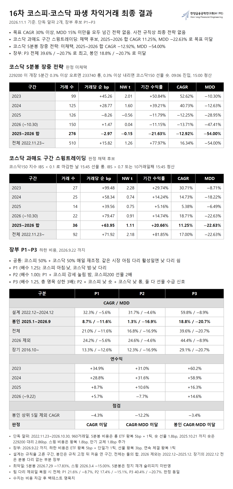
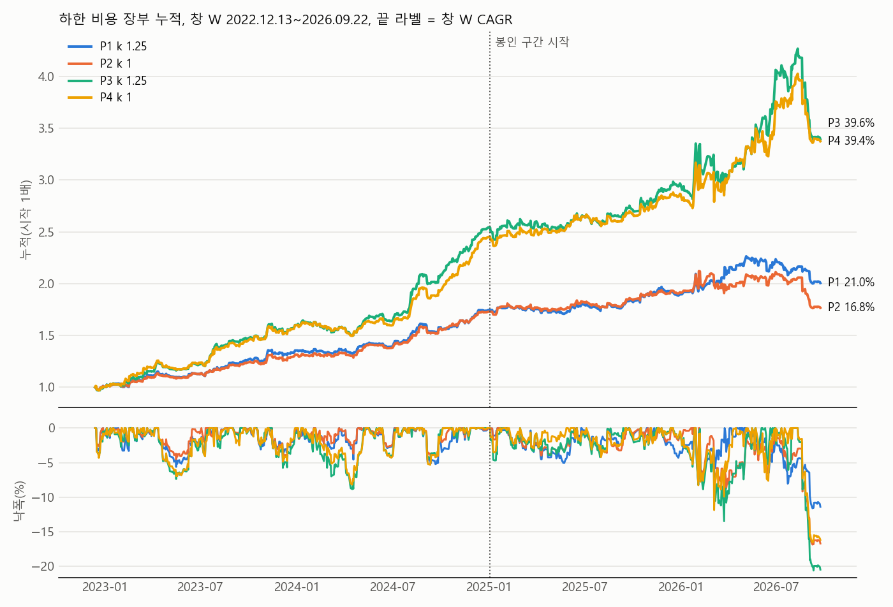

# 16차 코스피·코스닥 알파 탐색: 단독 알파 상위 3개, 장부 후보 3개

2026-10-31 기준. 목표 CAGR 30% 이상 ∧ MDD 15% 미만. 자료 2022-11~2026-09(4절 두 전략은 ~2026-10-30), 수치는 비용 차감 후 백테스트.

## 1 결론

• 사전 등록 목표를 봉인 구간까지 넘긴 장부는 없다. 사전 규칙상 최종 전략 없음.
• 규칙을 고른 설계 구간(~2024-12)에서는 세 장부 모두 목표를 넘었으나, 규칙을 고른 뒤 처음 연 봉인 구간(2025-01~)에서 크게 줄었다.
• 단독 상위 3개 중 봉인 판정을 통과한 것은 코스닥 과매도 구간 스윙트레이딩 1개다. 이 알파도 MDD −22.6% 로 목표 밖이다.
• 자료를 2026-10-30 까지 늘린 2025~2026 합: 코스닥 5분봉 장중 전략 CAGR −12.9% / MDD −54.0%, 코스닥 과매도 구간 스윙트레이딩 CAGR 11.3% / MDD −22.6%(4절).
• 장부 중 P3 가 전체 창 CAGR 39.6% 로 가장 높고 MDD −20.7% 로 목표에 못 미친다.

## 2 평가 방법

• 창: 설계 2022-12-13~2024-12-30(502일), 봉인 2025-01-02~2026-09-22(420일, 단독 다리는 2026-09-29 까지 423일), 전체 = 설계 + 봉인, 2026 제외 2022-12-13~2025-12-30, 장기 2016-10-04~(2022-12 전은 분봉 다리 없는 부분 장부).
• 비용 기본: ETF 왕복 5bp, 선물 왕복 1.8bp × 명목, 연속 체결이 끼면 왕복 1틱, 낮 숏 선물 대리 1.06bp × 명목.
• 비용 하한: 기본 + 단일가 ETF 1틱 + 선물 3bp.
• 단독 판정: 설계 선별 통과 ∧ 봉인 순수익 > 0 ∧ 봉인 NW t ≥ 1.
• 장부 최종 선택: 하한 비용에서 전체·2026 제외·봉인 각각 CAGR ≥ 30% ∧ MDD < 15% ∧ 장기 MDD < 15%. 규칙은 봉인을 열기 전에 고정했다.
• 스캔 8관점 24,402셀 중 선별. 상위 3개는 선별 통과 다리를 설계 구간 CAGR 로 정렬한 값이다.

## 3 단독 알파 상위 3개 (기본 비용)

| 알파 | 유형 | 설계 CAGR / MDD | 봉인 CAGR / MDD | 전체 CAGR / MDD | 봉인 n | 봉인 순 bp | 봉인 NW t | 판정 |
|---|---|---|---|---|---:|---:|---:|---|
| 코스닥 5분봉 장중 전략 | 데이 | 45.3% / −12.6% | −19.0% / −50.8% | 11.2% / −50.8% | 257 | −8.29 | −0.43 | 미채택 |
| 코스닥 과매도 구간 스윙트레이딩 | 스윙 | 24.3% / −18.2% | 14.2% / −22.6% | 19.6% / −22.6% | 33 | +78.69 | 1.29 | 채택 후보 |
| 코스피 낮 숏 | 데이 | 13.2% / −7.1% | 12.3% / −20.0% | 12.8% / −20.0% | 123 | +17.57 | 0.92 | 미채택 |

• 코스닥 5분봉 장중 전략
  · 규칙: KODEX 코스닥150(229200)이 개장 5분간 0.3% 이상 오르면 레버리지 롱, 0.3% 이상 내리면 숏. 09:06 진입, 15:00 청산. 롱 233740, 숏 코스닥150 선물.
  · 수익원: 개장 직후 방향이 오후까지 이어지는 장중 모멘텀.
  · 결과: 봉인 구간 순수익 음수. 2026 일중 급변에서 2배 롱 손실이 컸다(2026-07-29 하루 −17.8%). 국면 필터는 jehyeong_ daynight 낮 규칙에서 결과를 본 뒤 뺐다.
• 코스닥 과매도 구간 스윙트레이딩
  · 규칙: 코스닥150 지수가 저가 근처에서 마감한 날(IBS < 0.1) 15:45 코스닥150 선물 매수, IBS > 0.7 인 날 또는 10거래일째 15:45 청산. 명목 1배.
  · 수익원: 투매 뒤 반등과 선물 할인 회복. 2016~2024 수익의 약 37% 가 선물 할인 회복이다.
  · 결과: 장기 2016-10~ 16.2% / −22.6%, 270거래, +59.94bp, NW t 3.68. 수익은 유지됐고 낙폭이 목표 밖이다.
• 코스피 낮 숏
  · 규칙: 코스피200 선물 개인 순매수 z60 ≥ 0.5 인 날의 다음 날 시가에 선물 매도, 15:45 환매. 명목 1배.
  · 수익원: 개인 저가 매수 뒤 하락 지속.
  · 결과: 봉인 순수익은 양수이나 NW t 0.92 로 기준 미달. 장기 2016-10~ 9.4% / −20.0%, n 718, +12.87bp, NW t 2.81. 인버스 ETF 는 호가 비용이 커서 선물이 전제다.

• 참고: 봉인 판정을 통과한 단독 알파는 코스닥 과매도 구간 스윙트레이딩, 코스닥 낮 롱(코스닥150 선물 외인 5일 누적, n 38, +72.90bp, NW t 1.93), 코스닥 밤 수급(n 97, +18.50bp, NW t 1.17) 3개다.

## 4 두 전략 갱신 백테스트 (~2026-10-30)

• 규칙은 3절 그대로. 자료를 마지막 거래일 2026-10-30 까지 늘렸다.
• 비용: 코스닥 5분봉 장중 전략 롱 ETF 왕복 5bp + 왕복 1틱, 숏 선물 실측 1.8bp, 대리 2.86bp. 코스닥 과매도 구간 스윙트레이딩 왕복 1.8bp, 만기 교체 왕복 1.8bp 추가.
• 숏 체결: 2025-10-22 부터 코스닥150 선물 1분봉 실측, 그 전은 229200 부호 반전 대리. 2025 이후 숏 148건은 실측 102건, 대리 46건.
• 재계산: 코드를 따로 작성한 두 계산에서 거래 510건, 92건의 날짜·방향이 모두 일치했다.

| 코스닥 5분봉 장중 전략 | 거래 수 | 거래당 순 bp | NW t | 기간 수익률 | CAGR | MDD |
|---|---:|---:|---:|---:|---:|---:|
| 2023 | 99 | +45.26 | 2.01 | +50.84% | 52.62% | −10.30% |
| 2024 | 125 | +28.77 | 1.60 | +39.21% | 40.73% | −12.63% |
| 2025 | 126 | −8.26 | −0.56 | −11.79% | −12.25% | −28.95% |
| 2026(~10-30) | 150 | +1.47 | 0.04 | −11.15% | −13.71% | −47.41% |
| 2025~2026 합 | 276 | −2.97 | −0.15 | −21.63% | −12.92% | −54.00% |
| 전체 2022-11-23~ | 510 | +15.82 | 1.26 | +77.97% | 16.34% | −54.00% |

| 코스닥 과매도 구간 스윙트레이딩 | 거래 수 | 거래당 순 bp | NW t | 기간 수익률 | CAGR | MDD |
|---|---:|---:|---:|---:|---:|---:|
| 2023 | 27 | +99.48 | 2.28 | +29.74% | 30.71% | −8.71% |
| 2024 | 25 | +58.34 | 0.74 | +14.24% | 14.73% | −18.22% |
| 2025 | 14 | +39.56 | 0.75 | +5.16% | 5.38% | −6.49% |
| 2026(~10-30) | 22 | +79.47 | 0.91 | +14.74% | 18.71% | −22.63% |
| 2025~2026 합 | 36 | +63.95 | 1.11 | +20.66% | 11.25% | −22.63% |
| 전체 2022-11-23~ | 92 | +71.92 | 2.18 | +81.85% | 17.00% | −22.63% |

| 코스닥 5분봉 장중 전략 분해 | 거래 수 | 거래당 순 bp | NW t | 기간 수익률 | CAGR | MDD |
|---|---:|---:|---:|---:|---:|---:|
| 2025~2026 롱 | 128 | −25.23 | −0.75 | −36.16% | −22.49% | −58.48% |
| 2025~2026 숏 | 148 | +16.28 | 0.99 | +22.76% | 12.34% | −19.07% |
| 전체 롱 | 257 | +3.98 | 0.20 | −7.75% | −2.09% | −58.48% |
| 전체 숏 | 253 | +27.84 | 2.43 | +92.92% | 18.83% | −19.07% |

• 코스닥 5분봉 장중 전략
  · 2023~2024 합 CAGR 46.57% 에서 2025~2026 합 −12.92% 로 부호가 바뀌었다.
  · 손실은 2배 롱에서 나왔다. 숏은 양수지만 2025~2026 합 NW t 0.99 다.
  · 3절 MDD −50.8% 보다 깊은 이유는 2026-06-08 거래다. 그날 09:05~09:33 무체결이라 3절은 제외했고, 이 표는 재개 뒤 첫 체결로 밀어 −642.95bp 를 넣었다. 3절 n 257 과 별도 재계산 n 258 의 차이도 이 하루다.
  · 2026 거래 정지 구간의 재개 슬리피지는 반영하지 않았다. 큰 손실일이 정지일에 몰려 있어 수치보다 나쁠 수 있다.
• 코스닥 과매도 구간 스윙트레이딩
  · 2025~2026 합은 36건, NW t 1.11 로 표본이 작다.
  · 최악일 2026-03-04 −15.00%. 왕복 3bp 스트레스에서 2025~2026 합 CAGR 10.98%.
• 표 전체(월별, 숏 실측·대리, 정지일, 적용 기록): [priority_two_tables.md](priority_two_tables.md)

## 5 장부 후보 3개 (하한 비용)

| 장부 | 배수 | 설계 | 봉인 | 전체 | 2026 제외 | 장기 | 판정 |
|---|---:|---|---|---|---|---|---|
| P1 | 1.25 | 32.3% / −5.6% | 8.7% / −11.6% | 21.0% / −11.6% | 24.2% / −5.6% | 13.3% / −12.6% | CAGR 미달 |
| P2 | 1.00 | 31.7% / −4.6% | 1.3% / −16.9% | 16.8% / −16.9% | 24.6% / −4.6% | 12.3% / −16.9% | CAGR·MDD 미달 |
| P3 | 1.25 | 59.8% / −8.9% | 18.8% / −20.7% | 39.6% / −20.7% | 44.4% / −8.9% | 29.1% / −20.7% | 봉인 CAGR·MDD 미달 |

| 연수익, 하한 비용 | 2023 | 2024 | 2025 | 2026(~09-22) |
|---|---:|---:|---:|---:|
| P1 | +34.9% | +28.8% | +8.7% | +5.7% |
| P2 | +31.0% | +31.6% | +10.6% | −7.7% |
| P3 | +60.2% | +58.9% | +16.3% | +14.6% |

• 공통: 코스피 50% + 코스닥 50% 매일 재조정, 같은 시장에서 아침 다리 활성일엔 낮 다리 쉼, 위험 규칙 없음. 그림의 P4 는 P3 에 스윙 다리를 더한 사전 등록 장부로 전체 39.4% / −16.6%, 봉인 21.1% / −16.6%(하한)이고 역시 미달이다.
• P1, 기존 다리 실행판
  · 코스피 아침: C3 신호를 09:00 단일가로 확인한 뒤 09:01 첫 체결 진입, −3% 손절, 15:30 청산.
  · 코스피 낮: jehyeong_KP 장중 모멘텀, 왕복 1틱 반영.
  · 코스닥 밤: IBS·MA10 국면 신호를 15:30 종가로 확인한 뒤 15:45 코스닥150 선물 진입(+2배, −1배), 다음 시가 청산.
  · 코스닥 낮: jehyeong_KQ 장중 모멘텀, 숏은 선물.
• P2, P1 + 코스피 강세 눌림 밤
  · 코스피와 코스닥이 모두 20일선 위인데 코스피 IBS < 0.3 으로 마감한 날 15:45 코스피200 선물 2배 매수, 다음 시가 매도.
  · 설계 구간 낙폭은 가장 얕았으나 이 다리가 봉인 구간에서 손실을 냈다(n 50, −20.54bp, NW t −0.53).
• P3, P2 + 낮 수급 다리 2개, 총 명목 상한 3배
  · 코스피 낮 숏(3절)과 코스닥 낮 롱(코스닥150 선물 외인 5일 합 z60 ≥ 1.5 → 다음 날 시가 매수, 15:45 청산)을 더했다.
  · 낙폭 −20.65%(2026-08-10~2026-09-09)의 주원인은 강세 눌림 밤의 갭 손실이다(2026-08-19 −9.23%, 08-31 −5.20%, 08-25 −3.39%).

## 6 단서

• 봉인 구간의 깨끗함: 일부 스캔 과정에서 2025·2026 집계가 노출됐다. jehyeong_ 장중 다리 규칙은 2026-10-08 전 표본으로 정해져 봉인 구간이 표본 밖이 아니다. 깨끗한 표본 밖에 가까운 것은 새 다리뿐이다.
• 채택 후보 3개의 표본 집중: 봉인 구간 상위 3건을 빼면 NW t 0.30~0.77 이다. 코스닥 밤 수급은 신호일과 비신호일 차이가 −2.10bp 로 밤 드리프트와 구분되지 않는다. 봉인 t 를 표본 밖 입증으로 인용하지 않는다.
• 수익 집중: 봉인 구간(하한) 상위 5일을 빼면 CAGR 이 P1 −4.3%, P2 −12.2%, P3 −3.4% 다.
• 배수: 하한 비용 전체 창에서 배수 1.0·1.25·1.5 어느 조합도 목표를 넘지 못했다.
• 사후 구성: 손실 다리를 뺀 장부는 사전 규칙상 포워드 후보로만 다루며 여기서 계산하지 않았다.
• 체결: 코스닥 낮 숏 일부는 229200 대리다. 선물 1분봉 실측 대조에서 총수익 차이는 +2.73bp(n 65, t 0.98), −1.20bp(n 94, t −1.78)다. 아침 손절은 일봉 저가 기준이고 2026 거래 정지 구간의 체결 지연은 미반영이다.
• 재검증: 봉인 구간 다리 6개(코스닥 밤, 강세 눌림 밤, 코스피 낮 숏, 코스닥 낮 롱, 코스닥 밤 수급, 과매도 스윙)를 사양만으로 독립 재계산해 순수익이 일치했다. 코스닥 5분봉 장중 전략은 별도 재계산 n 258, −10.05bp 로 결론이 같다(n 차이는 2026-06-08 하루). 장부 전체 창 차이는 P2 0.05%p, P3 0.55%p(총 명목 상한 해석).
• 반박 검토: 완료. major 0, minor 3, note 10. 미래 정보, 비용 누락, 롤 오류는 찾지 못했다.
• 팀 다리 제외일: jehyeong_ 장중 다리 시계열이 봉인 구간 거래 가능일을 코스피 64일, 코스닥 45일 빼고 있다. 복원한 하한 값: P1 전체 21.6% / −8.7%, 봉인 10.0%. P2 전체 17.4% / −15.1%, 봉인 2.3%. P3 전체 40.4% / −20.7%, 봉인 20.3%. 판정은 같다.
• 해석 격자: 총 명목 상한 4해석, 코스피 낮 숏의 아침 활성일 처리, 팀 제외일 복원, 아침 다리 재계산을 조합한 72셀에서 사전 규칙 통과 장부는 없다. 봉인 CAGR 최고 셀은 P4 전체 41.5% / −17.0%, 봉인 23.6% / −17.0%(하한)이고, 전체 MDD 최선 셀도 P4 −16.6% 다. 두 값은 서로 다른 셀이다.
• 미확인: 파생 계좌 요건, 수수료, 선물 양도세, 대규모 체결 충격.

## 7 파일

• series/: 상위 3개(QC_Df = 코스닥 5분봉 장중 전략, X_MRq = 코스닥 과매도 구간 스윙트레이딩, X_K2 = 코스피 낮 숏)와 장부(P1, P2, P3) 일수익. 열 date,pos,gross,net, 자본 1 기준, 밤 손익은 청산일 기록. 끝은 2026-09-29 다.
• final_summary.png: 단독 알파 2개, 장부 P1~P3 최종 결과 표 한 장.
• priority_two_tables.md: 4절 표 전체.
• legs.csv, books.csv, book_yearly.csv, contributions.csv: 창·비용별 수치.
• 코드: ../../../overnight_lab/topics/ 의 r16_eval_legs.py, r16_eval.py, r16_share_series.py, r16p_backtest.py 와 r16s_*.py.
• 재현 자료: 코스피200·코스닥150 선물 일봉과 1분봉, 2026-10 갱신분(KIS 시세 조회)은 저장소에 없다. 코드의 <OUT>, <raw>, <repo>, <local> 표기는 실행 환경에 맞게 바꾼다.
