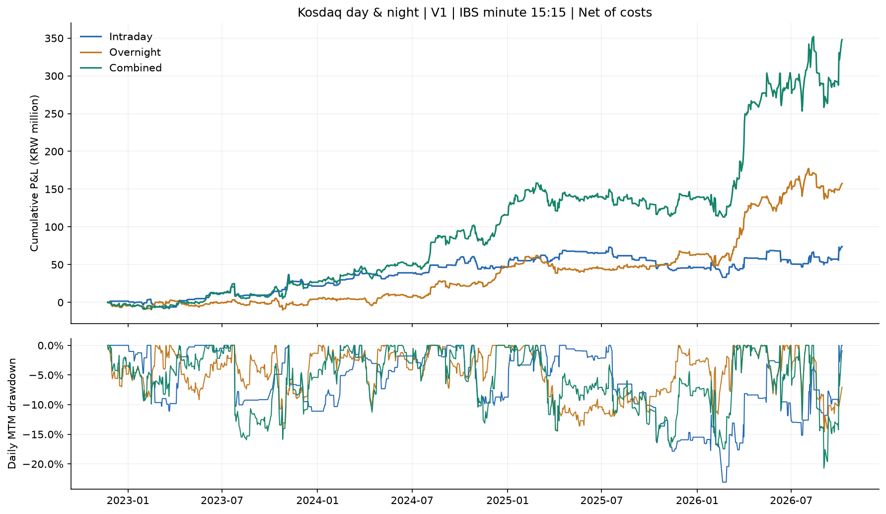
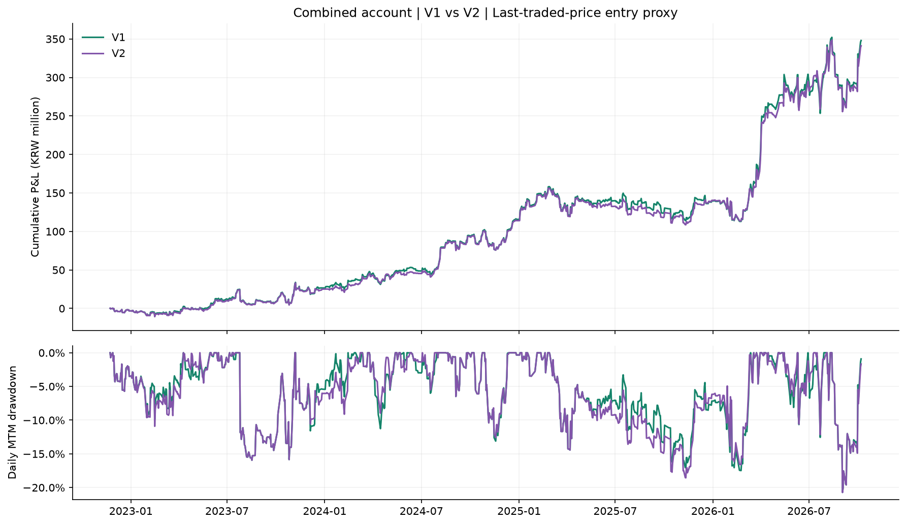
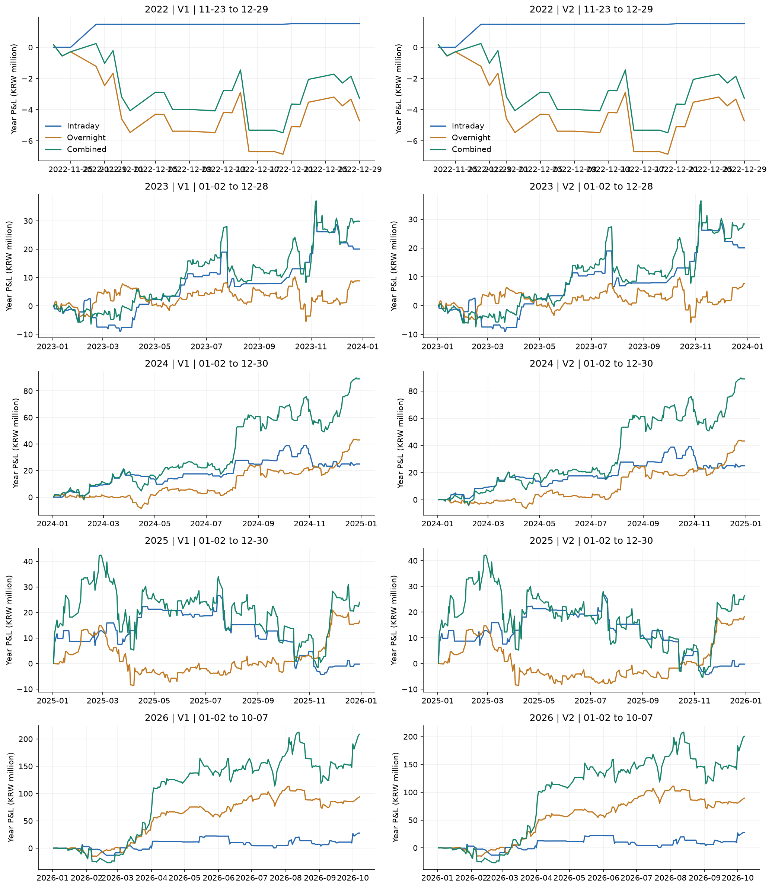

# Kosdaq day & night

공통 평가 구간: 2022-11-23 ~ 2026-10-07 (944거래일). 각 계좌 초기 자산: 100,000,000원.

15:20 진입은 승인된 직전 체결가 참고가격 가정입니다. 2022·2026년은 부분연도이며 모든 성과는 비용 차감 후입니다.

결합 계좌 CAGR은 V1 47.27%, V2 46.68%입니다.

## 전체 성과

| 버전 | 전략 | 시작일 | 종료일 | 거래일 | 수익률 | CAGR | MDD | Sharpe | 회전율(x) | 연환산 회전율(x/년) | 청산거래수 | P&L(원) |
| --- | --- | --- | --- | --- | --- | --- | --- | --- | --- | --- | --- | --- |
| V1 | 장중 | 2022-11-23 | 2026-10-07 | 944 | 73.88% | 15.35% | -23.06% | 0.77 | 504.65 | 134.71 | 252 | 73,877,652 |
| V1 | 오버나이트 | 2022-11-23 | 2026-10-07 | 944 | 157.63% | 27.67% | -14.90% | 1.25 | 1177.87 | 314.43 | 588 | 157,627,366 |
| V1 | 결합 | 2022-11-23 | 2026-10-07 | 944 | 347.96% | 47.27% | -20.73% | 1.43 | 1683.71 | 449.47 | 840 | 347,956,413 |
| V2 | 장중 | 2022-11-23 | 2026-10-07 | 944 | 73.88% | 15.35% | -23.06% | 0.77 | 504.65 | 134.71 | 252 | 73,877,652 |
| V2 | 오버나이트 | 2022-11-23 | 2026-10-07 | 944 | 153.66% | 27.16% | -14.90% | 1.24 | 1173.93 | 313.38 | 586 | 153,656,982 |
| V2 | 결합 | 2022-11-23 | 2026-10-07 | 944 | 341.05% | 46.68% | -20.73% | 1.43 | 1679.73 | 448.40 | 838 | 341,052,804 |

## 연도별 개별·결합 성과

| 버전 | 전략 | 연도 | 부분연도 | 시작일 | 종료일 | 거래일 | 수익률 | CAGR | MDD | Sharpe | 회전율(x) | 연환산 회전율(x/년) | 청산거래수 | P&L(원) |
| --- | --- | --- | --- | --- | --- | --- | --- | --- | --- | --- | --- | --- | --- | --- |
| V1 | 장중 | 2022 | True | 2022-11-23 | 2022-12-29 | 27 | 1.52% | 16.06% | 0.00% | 3.14 | 4.02 | 37.48 | 2 | 1,520,352 |
| V1 | 장중 | 2023 | False | 2023-01-02 | 2023-12-28 | 245 | 19.75% | 20.01% | -11.10% | 0.88 | 108.21 | 111.30 | 54 | 20,051,644 |
| V1 | 장중 | 2024 | False | 2024-01-02 | 2024-12-30 | 244 | 20.50% | 20.58% | -10.18% | 1.29 | 136.20 | 140.66 | 68 | 24,926,085 |
| V1 | 장중 | 2025 | False | 2025-01-02 | 2025-12-30 | 242 | -0.17% | -0.17% | -17.85% | 0.07 | 138.01 | 143.71 | 69 | -244,992 |
| V1 | 장중 | 2026 | True | 2026-01-02 | 2026-10-07 | 186 | 18.89% | 25.42% | -12.91% | 0.87 | 118.21 | 160.16 | 59 | 27,624,563 |
| V1 | 오버나이트 | 2022 | True | 2022-11-23 | 2022-12-29 | 27 | -4.71% | -37.90% | -7.02% | -2.09 | 33.92 | 316.57 | 17 | -4,712,040 |
| V1 | 오버나이트 | 2023 | False | 2023-01-02 | 2023-12-28 | 245 | 9.27% | 9.38% | -14.90% | 0.57 | 334.28 | 343.83 | 167 | 8,829,616 |
| V1 | 오버나이트 | 2024 | False | 2024-01-02 | 2024-12-30 | 244 | 41.38% | 41.55% | -10.25% | 1.99 | 300.72 | 310.58 | 150 | 43,086,855 |
| V1 | 오버나이트 | 2025 | False | 2025-01-02 | 2025-12-30 | 242 | 11.31% | 11.38% | -14.49% | 0.77 | 292.30 | 304.38 | 146 | 16,646,861 |
| V1 | 오버나이트 | 2026 | True | 2026-01-02 | 2026-10-07 | 186 | 57.23% | 80.84% | -14.57% | 1.98 | 216.66 | 293.54 | 108 | 93,776,074 |
| V1 | 결합 | 2022 | True | 2022-11-23 | 2022-12-29 | 27 | -3.26% | -27.93% | -5.71% | -1.40 | 37.96 | 354.28 | 19 | -3,263,328 |
| V1 | 결합 | 2023 | False | 2023-01-02 | 2023-12-28 | 245 | 30.85% | 31.26% | -15.94% | 1.05 | 442.61 | 455.26 | 221 | 29,841,143 |
| V1 | 결합 | 2024 | False | 2024-01-02 | 2024-12-30 | 244 | 70.37% | 70.68% | -13.11% | 2.36 | 437.27 | 451.61 | 218 | 89,073,851 |
| V1 | 결합 | 2025 | False | 2025-01-02 | 2025-12-30 | 242 | 11.12% | 11.20% | -17.07% | 0.58 | 430.44 | 448.23 | 215 | 23,985,909 |
| V1 | 결합 | 2026 | True | 2026-01-02 | 2026-10-07 | 186 | 86.93% | 126.81% | -20.73% | 2.06 | 335.43 | 454.45 | 167 | 208,318,838 |
| V2 | 장중 | 2022 | True | 2022-11-23 | 2022-12-29 | 27 | 1.52% | 16.06% | 0.00% | 3.14 | 4.02 | 37.48 | 2 | 1,520,352 |
| V2 | 장중 | 2023 | False | 2023-01-02 | 2023-12-28 | 245 | 19.75% | 20.01% | -11.10% | 0.88 | 108.21 | 111.30 | 54 | 20,051,644 |
| V2 | 장중 | 2024 | False | 2024-01-02 | 2024-12-30 | 244 | 20.50% | 20.58% | -10.18% | 1.29 | 136.20 | 140.66 | 68 | 24,926,085 |
| V2 | 장중 | 2025 | False | 2025-01-02 | 2025-12-30 | 242 | -0.17% | -0.17% | -17.85% | 0.07 | 138.01 | 143.71 | 69 | -244,992 |
| V2 | 장중 | 2026 | True | 2026-01-02 | 2026-10-07 | 186 | 18.89% | 25.42% | -12.91% | 0.87 | 118.21 | 160.16 | 59 | 27,624,563 |
| V2 | 오버나이트 | 2022 | True | 2022-11-23 | 2022-12-29 | 27 | -4.71% | -37.90% | -7.02% | -2.09 | 33.92 | 316.57 | 17 | -4,712,040 |
| V2 | 오버나이트 | 2023 | False | 2023-01-02 | 2023-12-28 | 245 | 8.01% | 8.11% | -14.90% | 0.51 | 336.23 | 345.84 | 168 | 7,635,408 |
| V2 | 오버나이트 | 2024 | False | 2024-01-02 | 2024-12-30 | 244 | 41.95% | 42.12% | -7.24% | 2.01 | 302.70 | 312.63 | 151 | 43,178,269 |
| V2 | 오버나이트 | 2025 | False | 2025-01-02 | 2025-12-30 | 242 | 12.51% | 12.59% | -14.49% | 0.86 | 290.31 | 302.30 | 145 | 18,275,685 |
| V2 | 오버나이트 | 2026 | True | 2026-01-02 | 2026-10-07 | 186 | 54.31% | 76.46% | -14.69% | 1.93 | 210.77 | 285.56 | 105 | 89,279,660 |
| V2 | 결합 | 2022 | True | 2022-11-23 | 2022-12-29 | 27 | -3.26% | -27.93% | -5.71% | -1.40 | 37.96 | 354.28 | 19 | -3,263,328 |
| V2 | 결합 | 2023 | False | 2023-01-02 | 2023-12-28 | 245 | 29.35% | 29.74% | -15.94% | 1.01 | 444.56 | 457.26 | 222 | 28,389,321 |
| V2 | 결합 | 2024 | False | 2024-01-02 | 2024-12-30 | 244 | 71.06% | 71.37% | -12.58% | 2.36 | 439.20 | 453.60 | 219 | 88,910,102 |
| V2 | 결합 | 2025 | False | 2025-01-02 | 2025-12-30 | 242 | 12.32% | 12.40% | -18.56% | 0.64 | 428.42 | 446.12 | 214 | 26,370,816 |
| V2 | 결합 | 2026 | True | 2026-01-02 | 2026-10-07 | 186 | 83.46% | 121.32% | -20.73% | 2.01 | 329.59 | 446.55 | 164 | 200,645,892 |

## P&L 및 낙폭

## 산식·체결·데이터 가정

시그널: KODEX 코스닥150(229200), 매수: 레버리지(233740) 또는 인버스(251340).
V1은 15:15 시작 분봉의 종가(15:16 확정), V2는 15:19 시작 분봉의 종가(15:20 확정)를 사용합니다.
저장된 원본 분봉은 종료 시각이므로 09:06 시가 체결은 원본 09:07 봉 시가입니다.
두 버전의 오버나이트 진입은 사용자가 승인한 15:20 직전 마지막 양의 거래량 분봉 종가를 참고가격으로 사용합니다.
이는 실제 15:20 시장가 체결을 보장하지 않는 연구용 가격 가정이며 V1의 원안 대비 승인된 체결가격 변경입니다.
V2는 15:20 신호 확정 직후 지연 없이 해당 참고가격으로 거래한다고 가정합니다.
각 거래에 계좌 현금 전액을 재투자하며 소수점 수량을 허용합니다. 추가 차입은 없고 현금 이자는 0입니다.
매수·매도 각각 수수료 1.5bp와 불리한 슬리피지 1bp를 적용합니다. 가격이 같으면 왕복 비용은 약 5bp입니다.
수수료를 포함하여 매수 수량을 계산하며 ETF 실제 가격을 사용합니다. 별도 배당·세금은 더하지 않습니다.
결합 계좌는 09:00 오버나이트 청산 → 09:06 장중 매수 → 15:00 장중 청산 → 15:20 오버나이트 매수 순으로 운용합니다.
일별 NAV는 15:30 종가 평가액입니다. 오버나이트 진입 당일의 비용·평가손익과 다음 거래일 청산손익을 각각 귀속합니다.
매매하지 않는 거래일도 일별 수익률에 포함합니다. 연도 사이 계좌 자산은 이어지며 연도별 수익률 기준은 전년도 마지막 NAV입니다.
CAGR=(기말NAV/기초NAV)^(365.25/관측기간 달력일수)-1; 달력일수는 첫 NAV 날짜의 전날부터 마지막 NAV 날짜까지입니다.
연도별 total_return은 실제 해당 연도 수익률이고 CAGR은 같은 공식을 적용한 연환산 값입니다. 부분연도의 CAGR은 실제 수익률과 다릅니다.
MDD는 기초자산을 고점에 포함한 일별 평가 NAV 낙폭이며 장중 최대 손실은 아닙니다.
Sharpe=일별 수익률 평균/표본표준편차(ddof=1)×sqrt(252), 무위험수익률 0입니다. 수익률 분산이 0이면 정의되지 않아 NaN으로 표시합니다.
Turnover(x)=Σ(당일 매수·매도 체결대금 합계/전일NAV); annualized_turnover=turnover×252/거래일수입니다.
매수·매도 양방향 합산 회전율이므로 한 번 전액 매수·청산하면 약 2x입니다. 거래횟수와는 다른 지표입니다.
필수 체결봉이 없거나 거래량이 0이면 거래를 제외합니다. IBS는 09:00부터 해당 신호 분봉까지 모두 존재해야 계산합니다.
오버나이트의 다음 거래일은 필터링 전 229200 일봉 달력으로 정하며, 그날 09:00 체결봉이 없으면 신규 진입을 제외합니다.
이 사전 데이터 완전성 검사는 체결 가능성을 보장하지 않으며, 거래량 제한·시장 충격·호가잔량은 별도 모형화하지 않습니다.
마지막 표본일에는 표본 밖 청산이 필요한 오버나이트 신규 진입을 제외합니다. 제외 내역은 skips.csv에 기록합니다.
2022년 1월부터의 분봉은 보유하지 않아 2022년은 11월부터, 2026년은 데이터 종료일까지의 부분연도입니다.

제외 내역 32행(버전별 신호/데이터 제외 사유).

KRX는 15:20~15:30을 종가 동시호가 구간으로 구분합니다: [KRX 거래 안내](https://global.krx.co.kr/contents/GLB/01/0109/0109000000/guide_to_trading_in_the_korean_stock_market.pdf).

기계 판독 원자료: summary.csv, yearly.csv, daily_nav.csv, orders.csv, trades.csv, signals.csv, skips.csv, data_quality.csv, manifest.json.
