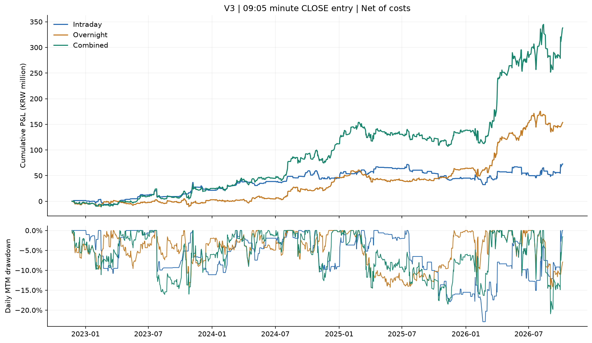
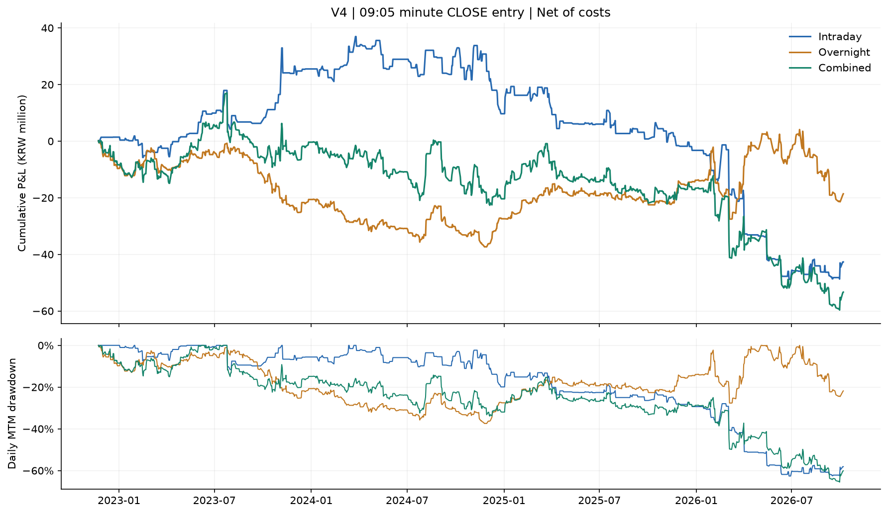
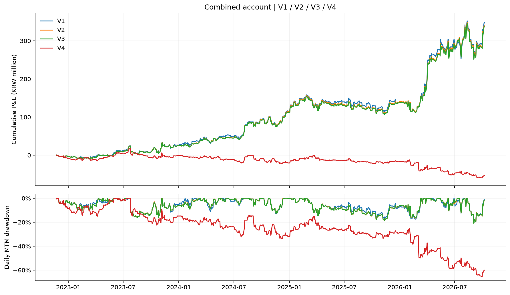
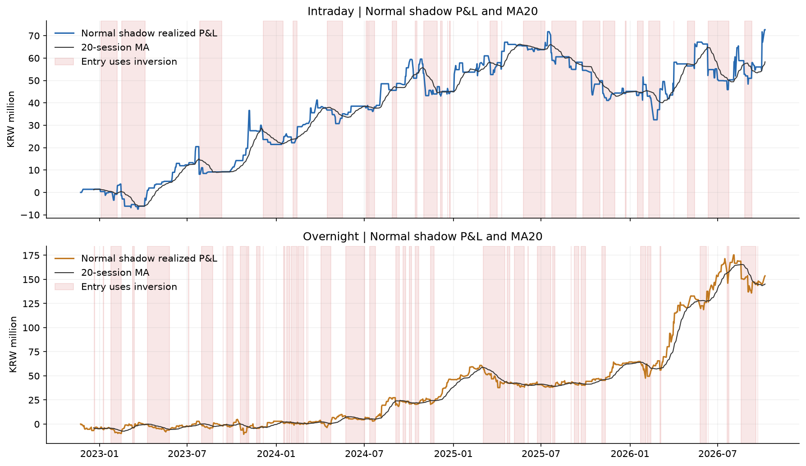
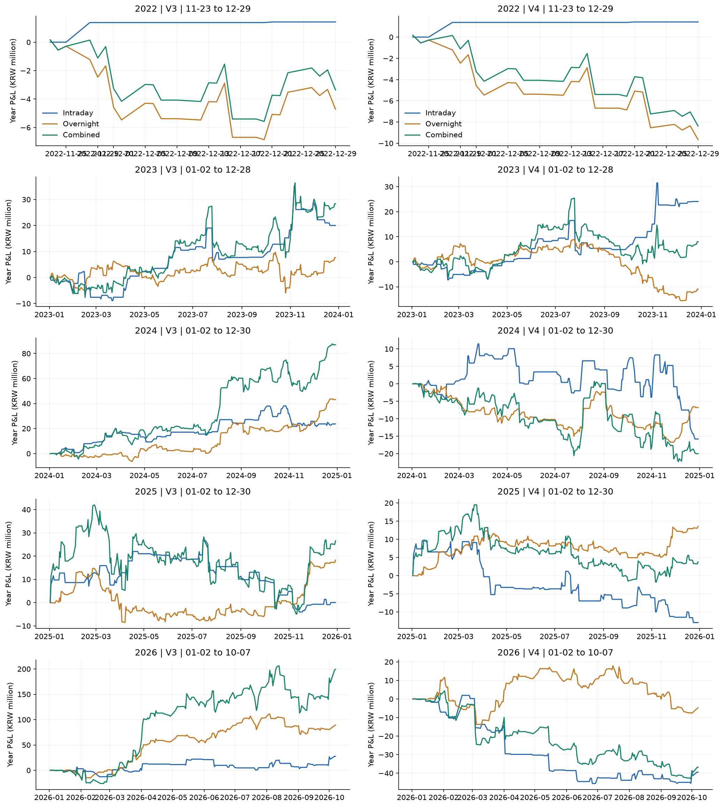

# Kosdaq V3 / V4

평가 구간: 2022-11-23~2026-10-07 · 944거래일 · 각 계좌 초기 100,000,000원

## 전체 성과

| 버전 | 전략 | 시작일 | 종료일 | 거래일 | 수익률 | CAGR | MDD | Sharpe | 회전율(x) | 연환산 회전율(x/년) | 청산거래수 | P&L(원) | 반전거래수 |
| --- | --- | --- | --- | --- | --- | --- | --- | --- | --- | --- | --- | --- | --- |
| V3 | 장중 | 2022-11-23 | 2026-10-07 | 944 | 72.68% | 15.14% | -22.91% | 0.76 | 504.64 | 134.71 | 252 | 72,680,107 | 0 |
| V3 | 오버나이트 | 2022-11-23 | 2026-10-07 | 944 | 153.66% | 27.16% | -14.90% | 1.24 | 1173.93 | 313.38 | 586 | 153,656,982 | 0 |
| V3 | 결합 | 2022-11-23 | 2026-10-07 | 944 | 338.02% | 46.42% | -20.94% | 1.42 | 1679.73 | 448.40 | 838 | 338,015,147 | 0 |
| V4 | 장중 | 2022-11-23 | 2026-10-07 | 944 | -42.67% | -13.38% | -62.62% | -0.41 | 503.58 | 134.43 | 252 | -42,667,438 | 111 |
| V4 | 오버나이트 | 2022-11-23 | 2026-10-07 | 944 | -18.61% | -5.18% | -37.47% | -0.15 | 1173.58 | 313.29 | 587 | -18,606,165 | 239 |
| V4 | 결합 | 2022-11-23 | 2026-10-07 | 944 | -53.33% | -17.86% | -65.54% | -0.41 | 1677.17 | 447.72 | 839 | -53,334,829 | 350 |

## V1~V4 비교

| 버전 | 전략 | 시작일 | 종료일 | 거래일 | 수익률 | CAGR | MDD | Sharpe | 회전율(x) | 연환산 회전율(x/년) | 청산거래수 | P&L(원) |
| --- | --- | --- | --- | --- | --- | --- | --- | --- | --- | --- | --- | --- |
| V1 | 장중 | 2022-11-23 | 2026-10-07 | 944 | 73.88% | 15.35% | -23.06% | 0.77 | 504.65 | 134.71 | 252 | 73,877,652 |
| V1 | 오버나이트 | 2022-11-23 | 2026-10-07 | 944 | 157.63% | 27.67% | -14.90% | 1.25 | 1177.87 | 314.43 | 588 | 157,627,366 |
| V1 | 결합 | 2022-11-23 | 2026-10-07 | 944 | 347.96% | 47.27% | -20.73% | 1.43 | 1683.71 | 449.47 | 840 | 347,956,413 |
| V2 | 장중 | 2022-11-23 | 2026-10-07 | 944 | 73.88% | 15.35% | -23.06% | 0.77 | 504.65 | 134.71 | 252 | 73,877,652 |
| V2 | 오버나이트 | 2022-11-23 | 2026-10-07 | 944 | 153.66% | 27.16% | -14.90% | 1.24 | 1173.93 | 313.38 | 586 | 153,656,982 |
| V2 | 결합 | 2022-11-23 | 2026-10-07 | 944 | 341.05% | 46.68% | -20.73% | 1.43 | 1679.73 | 448.40 | 838 | 341,052,804 |
| V3 | 장중 | 2022-11-23 | 2026-10-07 | 944 | 72.68% | 15.14% | -22.91% | 0.76 | 504.64 | 134.71 | 252 | 72,680,107 |
| V3 | 오버나이트 | 2022-11-23 | 2026-10-07 | 944 | 153.66% | 27.16% | -14.90% | 1.24 | 1173.93 | 313.38 | 586 | 153,656,982 |
| V3 | 결합 | 2022-11-23 | 2026-10-07 | 944 | 338.02% | 46.42% | -20.94% | 1.42 | 1679.73 | 448.40 | 838 | 338,015,147 |
| V4 | 장중 | 2022-11-23 | 2026-10-07 | 944 | -42.67% | -13.38% | -62.62% | -0.41 | 503.58 | 134.43 | 252 | -42,667,438 |
| V4 | 오버나이트 | 2022-11-23 | 2026-10-07 | 944 | -18.61% | -5.18% | -37.47% | -0.15 | 1173.58 | 313.29 | 587 | -18,606,165 |
| V4 | 결합 | 2022-11-23 | 2026-10-07 | 944 | -53.33% | -17.86% | -65.54% | -0.41 | 1677.17 | 447.72 | 839 | -53,334,829 |

## 연도별 성과

| 버전 | 전략 | 연도 | 부분연도 | 시작일 | 종료일 | 거래일 | 수익률 | CAGR | MDD | Sharpe | 회전율(x) | 연환산 회전율(x/년) | 청산거래수 | P&L(원) | 반전거래수 |
| --- | --- | --- | --- | --- | --- | --- | --- | --- | --- | --- | --- | --- | --- | --- | --- |
| V3 | 장중 | 2022 | True | 2022-11-23 | 2022-12-29 | 27 | 1.42% | 14.97% | 0.00% | 3.15 | 4.01 | 37.47 | 2 | 1,423,481 | 0 |
| V3 | 장중 | 2023 | False | 2023-01-02 | 2023-12-28 | 245 | 19.72% | 19.98% | -11.11% | 0.88 | 108.21 | 111.30 | 54 | 20,002,248 | 0 |
| V3 | 장중 | 2024 | False | 2024-01-02 | 2024-12-30 | 244 | 19.49% | 19.57% | -10.35% | 1.24 | 136.19 | 140.66 | 68 | 23,671,818 | 0 |
| V3 | 장중 | 2025 | False | 2025-01-02 | 2025-12-30 | 242 | 0.02% | 0.02% | -17.88% | 0.08 | 138.01 | 143.72 | 69 | 25,994 | 0 |
| V3 | 장중 | 2026 | True | 2026-01-02 | 2026-10-07 | 186 | 18.99% | 25.56% | -12.71% | 0.87 | 118.21 | 160.16 | 59 | 27,556,564 | 0 |
| V3 | 오버나이트 | 2022 | True | 2022-11-23 | 2022-12-29 | 27 | -4.71% | -37.90% | -7.02% | -2.09 | 33.92 | 316.57 | 17 | -4,712,040 | 0 |
| V3 | 오버나이트 | 2023 | False | 2023-01-02 | 2023-12-28 | 245 | 8.01% | 8.11% | -14.90% | 0.51 | 336.23 | 345.84 | 168 | 7,635,408 | 0 |
| V3 | 오버나이트 | 2024 | False | 2024-01-02 | 2024-12-30 | 244 | 41.95% | 42.12% | -7.24% | 2.01 | 302.70 | 312.63 | 151 | 43,178,269 | 0 |
| V3 | 오버나이트 | 2025 | False | 2025-01-02 | 2025-12-30 | 242 | 12.51% | 12.59% | -14.49% | 0.86 | 290.31 | 302.30 | 145 | 18,275,685 | 0 |
| V3 | 오버나이트 | 2026 | True | 2026-01-02 | 2026-10-07 | 186 | 54.31% | 76.46% | -14.69% | 1.93 | 210.77 | 285.56 | 105 | 89,279,660 | 0 |
| V3 | 결합 | 2022 | True | 2022-11-23 | 2022-12-29 | 27 | -3.36% | -28.60% | -5.73% | -1.45 | 37.96 | 354.26 | 19 | -3,355,634 | 0 |
| V3 | 결합 | 2023 | False | 2023-01-02 | 2023-12-28 | 245 | 29.31% | 29.71% | -16.09% | 1.01 | 444.57 | 457.27 | 222 | 28,331,084 | 0 |
| V3 | 결합 | 2024 | False | 2024-01-02 | 2024-12-30 | 244 | 69.63% | 69.93% | -12.63% | 2.33 | 439.19 | 453.58 | 219 | 87,014,443 | 0 |
| V3 | 결합 | 2025 | False | 2025-01-02 | 2025-12-30 | 242 | 12.53% | 12.61% | -18.50% | 0.65 | 428.42 | 446.13 | 214 | 26,560,299 | 0 |
| V3 | 결합 | 2026 | True | 2026-01-02 | 2026-10-07 | 186 | 83.62% | 121.56% | -20.94% | 2.01 | 329.60 | 446.55 | 164 | 199,464,954 | 0 |
| V4 | 장중 | 2022 | True | 2022-11-23 | 2022-12-29 | 27 | 1.42% | 14.97% | 0.00% | 3.15 | 4.01 | 37.47 | 2 | 1,423,481 | 0 |
| V4 | 장중 | 2023 | False | 2023-01-02 | 2023-12-28 | 245 | 23.75% | 24.06% | -11.59% | 1.06 | 108.24 | 111.33 | 54 | 24,086,918 | 23 |
| V4 | 장중 | 2024 | False | 2024-01-02 | 2024-12-30 | 244 | -12.60% | -12.64% | -19.91% | -0.58 | 135.89 | 140.34 | 68 | -15,814,594 | 24 |
| V4 | 장중 | 2025 | False | 2025-01-02 | 2025-12-30 | 242 | -11.80% | -11.87% | -18.91% | -0.73 | 137.89 | 143.58 | 69 | -12,944,821 | 38 |
| V4 | 장중 | 2026 | True | 2026-01-02 | 2026-10-07 | 186 | -40.74% | -49.59% | -48.13% | -1.31 | 117.56 | 159.27 | 59 | -39,418,422 | 26 |
| V4 | 오버나이트 | 2022 | True | 2022-11-23 | 2022-12-29 | 27 | -9.67% | -63.34% | -9.82% | -4.16 | 33.81 | 315.59 | 17 | -9,666,201 | 1 |
| V4 | 오버나이트 | 2023 | False | 2023-01-02 | 2023-12-28 | 245 | -12.12% | -12.25% | -24.64% | -0.70 | 335.79 | 345.38 | 168 | -10,944,349 | 74 |
| V4 | 오버나이트 | 2024 | False | 2024-01-02 | 2024-12-30 | 244 | -8.56% | -8.59% | -21.19% | -0.41 | 301.86 | 311.76 | 151 | -6,798,549 | 62 |
| V4 | 오버나이트 | 2025 | False | 2025-01-02 | 2025-12-30 | 242 | 18.74% | 18.86% | -8.75% | 1.41 | 290.25 | 302.24 | 145 | 13,600,757 | 63 |
| V4 | 오버나이트 | 2026 | True | 2026-01-02 | 2026-10-07 | 186 | -5.57% | -7.22% | -25.97% | -0.05 | 211.87 | 287.05 | 106 | -4,797,822 | 39 |
| V4 | 결합 | 2022 | True | 2022-11-23 | 2022-12-29 | 27 | -8.38% | -57.85% | -8.53% | -3.55 | 37.85 | 353.29 | 19 | -8,380,316 | 1 |
| V4 | 결합 | 2023 | False | 2023-01-02 | 2023-12-28 | 245 | 8.76% | 8.86% | -22.44% | 0.44 | 444.40 | 457.10 | 222 | 8,022,332 | 97 |
| V4 | 결합 | 2024 | False | 2024-01-02 | 2024-12-30 | 244 | -20.08% | -20.15% | -22.94% | -0.75 | 437.61 | 451.96 | 219 | -20,012,843 | 86 |
| V4 | 결합 | 2025 | False | 2025-01-02 | 2025-12-30 | 242 | 4.72% | 4.75% | -21.47% | 0.34 | 428.21 | 445.91 | 214 | 3,762,104 | 101 |
| V4 | 결합 | 2026 | True | 2026-01-02 | 2026-10-07 | 186 | -44.04% | -53.23% | -54.05% | -1.05 | 329.10 | 445.87 | 165 | -36,726,106 | 65 |

V3는 V2를 기준으로 장중 진입 가격만 09:05 시작 분봉 종가(원본 09:06 종료 봉 종가)로 변경합니다. 신호 판단은 기존 09:05 시가를 그대로 사용하고 장중 청산은 15:00 시가입니다.
오버나이트는 V2와 같이 15:19 분봉 종가로 IBS를 계산하고 15:20 직전 마지막 실제 체결가를 참고가격으로 진입하며, 다음 거래일 09:00 시가에 청산합니다.
V4는 V3에 두 개의 독립적인 정상 전략 모의 계좌를 추가합니다. 각 모의 계좌는 최초 1억원에서 시작해 비용을 반영하고 정상 방향으로 계속 운용됩니다. 이 계좌들은 매매 방향 판단용이며 결합 계좌의 자금을 차감하지 않습니다.
각 전략의 포지션이 청산되면 모의 계좌의 누적 확정 P&L을 현재 관측값으로 삼고, 직전 19거래일 말의 확정 P&L과 함께 MA20을 계산합니다. 거래가 없는 날은 직전 확정 P&L을 유지해 평균에 포함하며, 20개 관측치가 쌓이기 전에는 정상 방향입니다.
청산 직후 정상 모의 P&L < MA20이면 해당 전략의 다음 시그널 방향을 반전하고, P&L >= MA20이면 정상으로 복귀합니다. 포지션 청산이 없는 날에는 반전 상태를 변경하지 않습니다.
장중 진입은 당일 15:00 청산 전 상태를 사용하고, 오버나이트 진입은 당일 09:00 청산 후 상태를 사용합니다. 당일 뒤에 발생할 청산손익을 미리 사용하지 않습니다.
롱·숏 반전은 레버리지 ETF(233740) 매수와 인버스 ETF(251340) 매수를 교환합니다. 실제 반전 ETF의 가격·수량·비용으로 계산하므로 수익률의 단순 부호 반전과 다릅니다. 매번 현금 전액을 투자하며 소수점 수량을 허용합니다.
정상 전략 모의 P&L은 청산된 거래의 손익만 반영합니다. 표시 성과의 NAV·MDD·Sharpe는 종전과 같은 매 거래일 15:30 종가 평가 기준이며, 두 기준을 구분합니다.
매수·매도 편도 수수료 1.5bp와 불리한 슬리피지 1bp를 적용합니다. CAGR은 관측 달력 기간, Sharpe는 무위험수익률 0·표본표준편차·sqrt(252), 회전율은 양방향 거래대금/전일 NAV의 합입니다.
15:20 참고가격 체결과 분봉 종가 체결은 이상적 체결가격 가정입니다. 필수 체결봉·다음 거래일 시가의 거래량이 없으면 해당 ETF 거래를 제외하고 사유를 남깁니다. 반전 ETF의 거래 가능 여부는 정상 ETF와 별도로 확인합니다.
초기 관측치 이전의 모의 계좌 이력은 사용하지 않습니다. 2022·2026년은 부분연도이며 모든 성과는 비용 차감 후입니다. V1·V2 원본 파일과 결과는 보존합니다.

