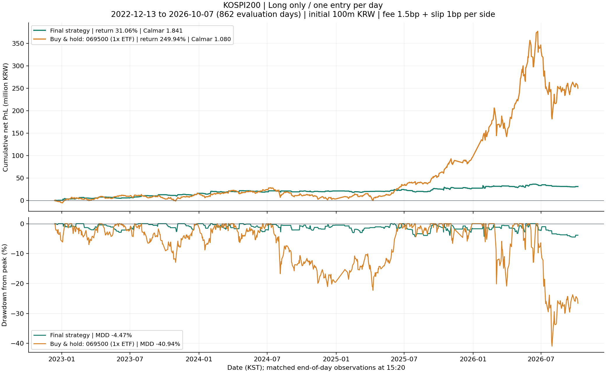
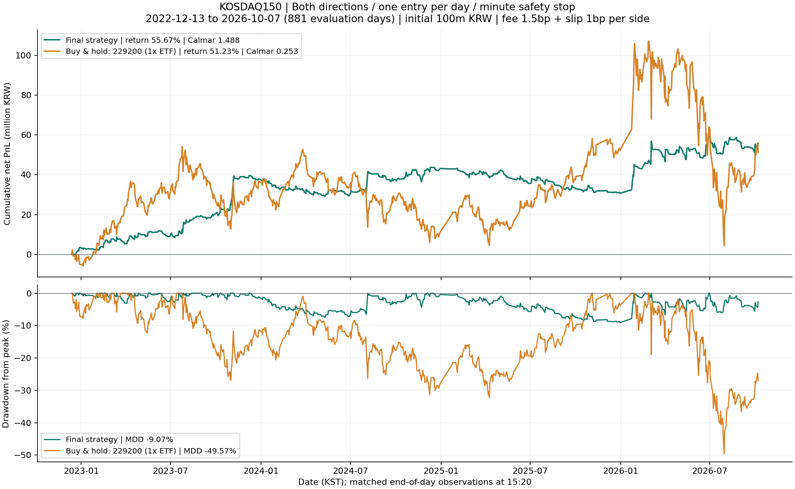

# 최종 장중 모멘텀 전략 2개

평가 기간: 2022-12-13~2026-10-07. 초기자본은 시장별 100,000,000원이다.
최종 전략은 거래당 매수/매도 수수료 각 1.5bp, 불리한 슬리피지 각 1bp를 반영한
실험 중 시장별 Calmar(CAGR / |일별 MDD|)가 가장 높은 전략이다.
코스피와 코스닥을 각각 독립적으로 운용한 결과이며, 두 시장을 합친 포트폴리오 결과는 아니다.

## 성과와 벤치마크

| 시장 | 구분 | 누적수익률 | CAGR | 일별 MDD | Calmar | 누적 순손익(만원) |
|---|---|---:|---:|---:|---:|---:|
| KOSPI200 | 최종 전략 | 31.06% | 8.23% | -4.47% | 1.841 | 3,106.0 |
| KOSPI200 | ETF 매수 후 보유 | 249.94% | 44.22% | -40.94% | 1.080 | 24,993.8 |
| KOSDAQ150 | 최종 전략 | 55.67% | 13.50% | -9.07% | 1.488 | 5,567.2 |
| KOSDAQ150 | ETF 매수 후 보유 | 51.23% | 12.56% | -49.57% | 0.253 | 5,122.9 |





위 그래프의 위쪽은 초기자본 대비 누적 순손익, 아래쪽은 직전 최고자산 대비 낙폭이다.
MDD는 아래쪽 곡선의 최저점이다. 두 곡선 모두 초기자본을 최초 고점에 포함한다.
전략과 벤치마크는 같은 날짜의 15:20에 자산을 평가한다.
벤치마크는 코스피 **069500 KODEX 200**, 코스닥 **229200 KODEX 코스닥150**의
비레버리지 ETF 가격수익률이다. 지수 자체 또는 분배금 재투자 총수익지수가 아니다.
첫 평가일 09:30의 다음 1분봉 open에 전액 매수하고, 마지막 평가일 15:20 close에 전량 매도한다.
그 사이에는 야간과 중간 제외일에도 계속 보유하며, 재매수·리밸런싱하지 않는다.
실제 매수 1회·매도 1회에 각각 동일한 수수료와 슬리피지를 적용한다.
중간 날짜에는 청산비용을 가상 공제하지 않고 종가로 평가하며, 마지막 날에 실제 청산비용을 반영한다.

CAGR는 기존 선정 기준을 유지하여 `(최종자산/초기자산) ** (252/평가일수) - 1`로 계산했다.
코스피 862일, 코스닥 881일이며, 두 시장의 평가 날짜가 서로 다를 수 있다.
특수 개장일·누락 봉·가격 불일치·워밍업 부족일 등은 제외된다. 제외일은 그래프에 새 관측점을 추가하지 않는다.
이 연율화는 달력 경과연수 기반 CAGR와 다르다. 벤치마크에도 동일한 시장별 평가일수를 적용했다.
일별 MDD보다 장중 낙폭이 크다. 전략의 1분봉 close 평가 MDD는
코스피 **-6.69%**, 코스닥 **-10.52%**다.
1분봉 내 고가·저가를 이용한 최악의 낙폭까지 측정한 값은 아니다.

## 공통 시그널·체결·비중

토스 1분봉을 09:00부터 30개씩 묶어 30분봉을 메모리에서 재구성한다.
신규 진입과 기본 청산 판단은 09:30, 10:00, …, 15:00에만 한다.
오늘 같은 시각의 가격과 당일 시가 간 절대수익률의 과거 **14거래일 평균**을 Noise로 사용한다.
상단밴드 = `max(당일 시가, 전일 종가) × (1+Noise)`;
하단밴드 = `min(당일 시가, 전일 종가) × (1-Noise)`이다.
30분봉 close가 상단을 넘으면 롱, 하단 아래면 숏 방향 시그널이다.
당일 데이터는 Noise와 변동성 추정에 포함하지 않는다.

Strength는 밴드 기준점 대비 돌파 폭을 Noise로 나눈 값이다.
Vol14는 전일까지의 일봉 close 수익률 14개 표본표준편차(ddof=1)이다.
목표 기초지수 노출 `L = min(시장별 상한, 0.02 / Vol14 × Strength)`를 사용한다.
노출은 시그널 때 정하고, ETF 수량은 체결 때 정해 청산까지 고정한다.
소수점 수량을 허용한 이상적 시뮬레이션이다. 정수 수량 실험은 --whole-shares로 실행한다.
수수료·슬리피지를 살 수량에 미리 반영하여 현금 차입을 허용하지 않는다.

일반 청산은 M1-P 규칙이다. 롱은 `close ≤ max(상단밴드, VWAP)`,
숏은 `close ≥ min(하단밴드, VWAP)`일 때 청산 의도를 만든다.
VWAP은 토스에 거래대금이 없어 **누적 30분봉 HLC3×거래량 / 누적 거래량** 근사치를 사용한다.
일반 진입·청산은 판단 봉이 끝난 직후 다음 1분봉 open에 체결한다.
토스 시간은 봉 종료 시각이므로 09:30 판단은 **09:31 행의 open(실제 09:30)** 체결이다.
거래량 0인 진입 봉은 취소하고, 거래량 0인 청산 봉은 다음 유효 봉까지 연기한다.
미청산 포지션은 요청대로 **15:20 봉 close**에 강제청산한다. 전략은 익일로 포지션을 넘기지 않는다.
매수가는 기준가×1.0001, 매도가는 기준가×0.9999, 수수료는 실제 체결금액×0.00015다.

## 코스피: 롱온리 + 하루 한 번 진입

- 대상: 069500 KODEX 200, 122630 KODEX 레버리지.
- 숏 시그널은 무시한다. 하루 첫 실제 진입만 허용하며, 청산 후 그날 재진입하지 않는다.
- `L ≤ 1`이면 069500에 자본의 L만큼 투자하고 나머지는 현금이다.
- `1 < L ≤ 2`이면 069500 비중 `2-L`, 122630 비중 `L-1`이다. 기초지수 명목노출 상한은 2배다.
- 기본 30분 청산과 15:20 강제청산을 사용한다. 별도 1분 보호청산은 없다.
- 총 280회 진입, 모두 롱이다. 시간 쿨다운은 0분이지만 하루 1회 제한이 재진입을 막는다.

개선의 핵심은 약했던 숏과 첫 거래 이후 추가 거래를 제거한 것이다.
이전 추가 진입 109회의 가격손익은 약 +190.5만원이었으나 거래비용 약 612.8만원으로 순손실 약 422.3만원이었다.
첫 롱 진입을 유지해 누적수익률과 일별 Calmar가 개선되었다.
남은 손실은 롱 돌파 실패, 거래비용, 레버리지 ETF로 확대한 장중 변동에서 발생한다.
평균 진입 목표노출은 1.728배다. 일별 MDD가 작아도 장중 위험까지 작다는 뜻은 아니다.

## 코스닥: 양방향 + 하루 한 번 진입 + 1분 보호청산

- 롱은 229200 KODEX 코스닥150, 숏 방향은 251340 KODEX 코스닥150선물인버스를 **매수**한다.
- ETF 공매도는 하지 않는다. 233740 레버리지 ETF는 사용하지 않는다.
- 첫 실제 진입만 허용하고, 목표노출 상한은 1배다. 투자하지 않은 자본은 현금이다.
- 기본 청산에 추가로 매분 close에서 보호청산을 판단한다. 기본 진입 판단은 여전히 30분이다.
- `R = 과거 20거래일 (일봉 high-low)/open의 중앙값`, 보호거리 `d = 0.25×R`이다.
- E는 진입 시각의 신호 ETF **229200** 다음 1분봉 open이다.
  롱은 신호 ETF close가 `E×(1-d)` 이하, 숏은 `E×(1+d)` 이상이면 보호청산 의도를 만든다.
  실제 보유 ETF(229200 또는 251340)를 다음 1분봉 open에 매도한다.
- 총 540회: 롱 274회, 숏 방향 266회다.

하루 1회만 진입하므로 보호청산은 신규 진입을 바꾸지 않고 큰 역행 손실의 출구를 앞당긴다.
과거 하루 1회 양방향 버전의 일별 MDD 12.50%가 9.07%, Calmar 0.964가 1.488로 개선되었다.
2023-07-26의 일손익률은 약 -6.27%에서 -1.42%로 줄었다.
보호청산은 모든 거래를 개선하지 않으며, 갭·체결 연기로 손실이 정해진 거리보다 커질 수 있다.
2025년 연간 손익은 여전히 음수였고, 인버스 방향 손실과 높은 거래비용이 남았다.
평균 진입 목표노출은 0.942배다.

## 보존 파일과 재실행

최종 전략의 보존 대상은 `data/`의 토스 일봉 **4개**와 `data/minute/`의 토스 1분봉 **4개**다.
종목은 069500, 122630, 229200, 251340이다. 원본 CSV를 수정하지 않았으며 SHA256을 확인했다.
원시 1분봉 가용 기간은 2022-11-23~2026-10-07이다. 일봉은 이전 구간도 보존하여 사전 지표 계산에 사용한다.
30분봉·15:20 봉은 1분봉에서 재구성하므로 별도 입력 CSV가 필요하지 않다.
KIS·키움 보조 데이터, 미사용 ETF 데이터, 수집 중간 파일, 합성 테스트 데이터, 이전 실험 결과는 삭제 대상이다.
실제 정리 상태는 아래의 정리 상태 항목과 `cleanup_manifest.json`에서 확인한다.

Python 코드는 기존 수집기와 최종 백테스터 **2개**다. 수집기는 이번 작업에서 실행하지 않았다.
최종 백테스터 기본 실행은 이 두 전략만 돌리고 `results/final/`의 결과를 갱신한다.
새 타임스탬프 실험 폴더를 만들지 않는다.

```powershell
& C:\Users\박제형\AppData\Local\Programs\Python\Python312\python.exe .\jehyeong\intraday\code\backtest_intraday_momentum.py
```

현재 작업 디렉터리와 관계없이 스크립트 위치 기준으로 data와 results를 찾는다.
`--start YYYY-MM-DD --end YYYY-MM-DD`로 평가 기간을 제한할 수 있다.
수집기를 다시 실행하면 원래 7개 ETF의 수집 중간 파일과 파생 데이터가 생성될 수 있다.

`selected_rules.json`은 최종 규칙, 원본 데이터 해시, 선정 시점의 평가 날짜와 참조 성과를 보존한다.
과거 공유 데이터 품질 필터로 제외했던 날짜는 입력을 4종목으로 줄였어도 다시 넣지 않았다.
향후 업데이트된 데이터에서는 참조 구간 종료일 이후의 정상 날짜만 추가한다.
변경된 입력 때문에 과거 평가일이 유효하지 않으면 조용히 다른 표본으로 바꾸지 않고 오류로 중단한다.
`run_manifest.json`과 `verification.json`에 실제 사용 날짜·데이터/코드 해시·검증 결과를 남긴다.
각 시장 폴더에는 일별 손익, 거래/주문 원장, 1분 자산, 기간별 성과, 품질 검사,
벤치마크 일별 자산/주문, PnL/MDD 그래프가 있다. `comparison_summary.csv`가 비교 성과표다.

검증은 종전 참조 성과 재현, 종전 거래/주문 원장 재현, 현금과 손익 일치,
수수료·슬리피지 계산, 하루 진입수·방향·노출 제한, 벤치마크 매수/매도 현금흐름을 포함한다.
최종 전략은 이미 관찰한 전체 기간에서 선정했다. 과거 기간을 나눠 본 결과가 있어도
독립적인 미관찰 구간 검증이나 향후 수익 보장은 아니다.

## 정리 상태: 삭제 미완료

자동 승인 검토가 재귀 일괄 삭제와 단일 CSV 삭제를 모두 정책상 차단했다.
차단 사유는 "blocked by policy"로만 제공되었다. 실제로 삭제한 파일은 **0개**다.
이전 파일들은 아직 intraday에 있으며, 최종 백테스터는 그 이력을 읽지 않는다.
삭제 대상은 1,338개 파일, 약 706.36 MiB다.
`cleanup_manifest.json`에 경로·보존 파일·정리 상태를 기록했다.
아래 명령은 사용자가 PowerShell에서 직접 실행할 수 있도록 제공한 것이며, 이번 작업에서 실행하지 않았다.
원본 CSV 8개의 해시와 모든 삭제 경로를 확인한 뒤 지정된 intraday 내부 대상만 제거한다.

```powershell
$ErrorActionPreference = 'Stop'
$root = (Resolve-Path -LiteralPath 'C:\Users\박제형\Desktop\Future_Trading\jehyeong\intraday').Path
$planPath = Join-Path $root 'results/final/cleanup_manifest.json'
$plan = Get-Content -LiteralPath $planPath -Raw -Encoding UTF8 | ConvertFrom-Json
if ($root -ne $plan.root) { throw 'Cleanup root mismatch' }
$prefix = $root.TrimEnd('\') + '\'
$items = @(Get-ChildItem -LiteralPath $root -Recurse -Force)
if (@($items | Where-Object { $_.Attributes -band [IO.FileAttributes]::ReparsePoint }).Count) {
    throw 'Reparse point detected; cleanup stopped'
}
$rules = Get-Content -LiteralPath (Join-Path $root 'results/final/selected_rules.json') -Raw -Encoding UTF8 | ConvertFrom-Json
foreach ($entry in $rules.input_sha256.PSObject.Properties) {
    $file = Join-Path (Join-Path $root 'data') $entry.Name
    if ((Get-FileHash -LiteralPath $file -Algorithm SHA256).Hash -ne $entry.Value) {
        throw "Input hash changed: $file"
    }
}
$targets = @($plan.deleted_targets | ForEach-Object {
    $path = Join-Path $root $_
    if (Test-Path -LiteralPath $path) {
        $resolved = (Resolve-Path -LiteralPath $path).Path
        if (-not $resolved.StartsWith($prefix, [StringComparison]::OrdinalIgnoreCase)) {
            throw "Unsafe target: $resolved"
        }
        $resolved
    }
})
foreach ($path in $targets) { Remove-Item -LiteralPath $path -Recurse -Force }
$plan.status = 'COMPLETE'
$plan.actual_deleted_file_count = $plan.planned_deleted_file_count
$plan.blocked_reason = $null
$plan | ConvertTo-Json -Depth 8 | Set-Content -LiteralPath $planPath -Encoding UTF8
Write-Output 'Cleanup complete. Rerun the final backtester to refresh this document.'
```
