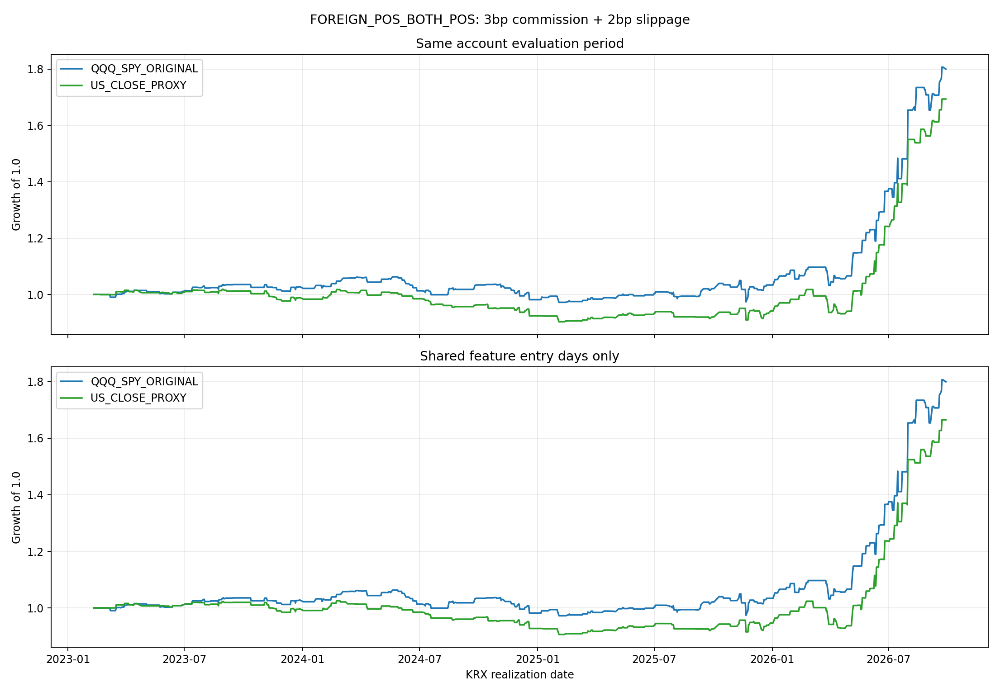

# FOREIGN_POS_BOTH_POS: 두 전략의 설명과 성과

## 비교 결과의 해석

같은 기간에서 기존 전략 CAGR 18.24%, 보정 proxy 16.20%로 proxy가 2.03%p 낮다. MDD도 기존 -8.52% 대비 proxy -11.30%로 깊다. 보정으로 비교할 수 있는 신호를 만들었지만, 기존 전략과 같은 성과·진입일을 복원했다고 볼 수 없다.
공통 feature 날짜 중 외국인 순매수가 양수인 414일에서 진입 결정 일치율은 75.36%다. 양쪽 모두 쉬는 외국인 비양수 날짜를 제외해 비교했다. 불일치 일자는 entry_disagreements.csv에서 확인할 수 있다.
직전 미국 종가 대조: QQQ 1126/1126일 일치; SPY 1126/1126일 일치. 같은 한국 의사결정일에 사용한 미국 기준 종가를 대조한 결과다. 외국인 수급은 두 전략 모두 원래의 전체 KRX 달력에서 1일 lag하므로 자료를 자른 후의 하루 이동은 없다. 남은 차이는 ETF의 미국 선물·추적·헤지 특성과 직전 한국 종가의 괴리 잔차가 직접 QQQ/SPY PREUS와 다르게 움직이는 데서 올 수 있다. 이 비교만으로 각 원인의 기여도를 분리할 수는 없다.

## 공통 거래 규칙

- 외국인 조건: KRX_foreign.xlsx의 직전 실제 KRX 거래일 외국인 순매수 > 0.
- 미국 방향 조건: 15:20까지 관측한 두 지표가 모두 양수이면 당일 KODEX200 종가 매수, 다음 실제 KRX 거래일 시가 매도.
- 롱 전용, 거래당 계좌 자본 100%, 미거래일은 현금 수익률 0. 전략마다 별도 계좌를 두며 계좌 간 주문·포지션을 합치지 않는다.
- 비용: 왕복 수수료 3bp + 왕복 슬리피지 2bp = 5bp. 기존 net_gap을 재차 차감하지 않고 kr_gap에서 정확히 0.0005를 한 번 차감한다.

## 1. 기존 QQQ·SPY 전략

QQQ와 SPY 각각 직전 미국 정규장 종가 대비 한국 당일 15:20까지 마지막 가격의 로그수익률을 사용한다. research_dataset.csv의 QQQ_preus_ret_1520·SPY_preus_ret_1520 두 값이 모두 > 0이어야 한다. 현재 직접 관측한 PREUS는 2023년부터 이용 가능하다.

## 2. 미국 종가 기준 보정 proxy 전략

QQQ proxy 304940와 SPY proxy 219480의 15:20까지 마지막 실제 거래 가격을 사용한다. 직전 한국 종가 이후 미국 종가까지의 움직임을 미국 일봉으로 제거한다.

```text
A = 직전 KRX 종가 당시 이미 알려진 QQQ/SPY 종가
B = 오늘 15:20 당시 이미 알려진 QQQ/SPY 종가
E0 = 직전 실제 KRX 거래일 proxy ETF 종가
E1 = 오늘 15:20까지 proxy ETF 마지막 거래 가격
보정 지표 = log(E1 / E0) - log(B / A)
          = log(E1 / (E0 * B / A))
```

미국 일봉 날짜는 미국 세션 날짜이며, 뉴욕 16:00 마감을 Asia/Seoul로 변환하여 의사결정 시각 이전 종가만 조회한다. 서머타임·한미 휴일을 반영한다. 거래량이 없는 15:20 봉은 이전의 당일 실제 거래를 사용하며, 미래·전일 체결 가격은 제외한다.

이 값은 관측된 QQQ/SPY PREUS를 그대로 복원한 수익률은 아니다. E0를 A에 대응시킨 가정과 ETF 추적 차이의 잔차가 남으므로 두 전략의 진입일이 완전히 같을 수는 없다. 미래 가격이나 성과에 맞춘 임계값은 사용하지 않는다.

## 평가 규약

모든 거래는 진입일·청산일을 별도로 기록한다. 손익과 왕복 비용은 청산일에 반영한다. 평가 시작일 이전에 진입한 거래와 평가 종료일 이후에 청산하는 거래를 제외하여 각 계좌를 같은 시점에 현금 1로 시작한다.
CAGR = 최종자산^(252 / 전체 KRX 평가일 수) − 1. Sharpe = 일별 순수익률 평균 / 표본 SD × √252, 무위험수익률 0. MDD에는 최초 자산 1을 포함하고 Calmar = CAGR / |MDD|이다. 미거래일도 모든 지표에 포함한다.
이번 성과는 이전 대화의 왕복 3bp·진입일 손익 표기와 비용 및 일자 정렬 규약이 달라 직접 같은 숫자로 비교하면 안 된다.

## 각 전략의 최대 이용 가능 기간

| 전략 | 평가기간 | 거래 | 누적수익률 | CAGR | MDD | Sharpe | Calmar |
|---|---|---:|---:|---:|---:|---:|---:|
| 미국 종가 기준 보정 proxy | 2021-12-20~2026-09-28 | 246 | 65.34% | 11.48% | -12.35% | 0.987 | 0.929 |
| 기존 QQQ·SPY PREUS | 2023-02-10~2026-09-28 | 213 | 79.97% | 18.24% | -8.52% | 1.340 | 2.140 |

## 동일 기간 비교

| 전략 | 평가기간 | 거래 | 누적수익률 | CAGR | MDD | Sharpe | Calmar |
|---|---|---:|---:|---:|---:|---:|---:|
| 미국 종가 기준 보정 proxy | 2023-02-10~2026-09-28 | 181 | 69.34% | 16.20% | -11.30% | 1.223 | 1.434 |
| 기존 QQQ·SPY PREUS | 2023-02-10~2026-09-28 | 213 | 79.97% | 18.24% | -8.52% | 1.340 | 2.140 |

## 공통 feature 날짜에만 진입

공통 feature 844일. 결측일에는 양쪽 모두 신규 진입하지 않으며, 전체 KRX 평가 달력은 유지한다.

| 전략 | 평가기간 | 거래 | 누적수익률 | CAGR | MDD | Sharpe | Calmar |
|---|---|---:|---:|---:|---:|---:|---:|
| 미국 종가 기준 보정 proxy | 2023-02-10~2026-09-28 | 169 | 66.53% | 15.65% | -11.62% | 1.189 | 1.346 |
| 기존 QQQ·SPY PREUS | 2023-02-10~2026-09-28 | 213 | 79.97% | 18.24% | -8.52% | 1.340 | 2.140 |

공통 자료 기준 동시 진입 140회, 기존만 진입 73회, 보정 proxy만 진입 29회. 날짜를 하루 밀어서 생긴 차이가 아니라 신호 부호 차이이다.



## 결과 파일

performance_summary.csv / strategy_comparison_summary.csv / daily_pnl.csv / strategy_trade_log.csv / strategy_signal_panel.csv / entry_disagreements.csv. 보정 전 proxy와 단순 보유·매일 매매 비교는 현재 실행 코드에서 제거했다.
