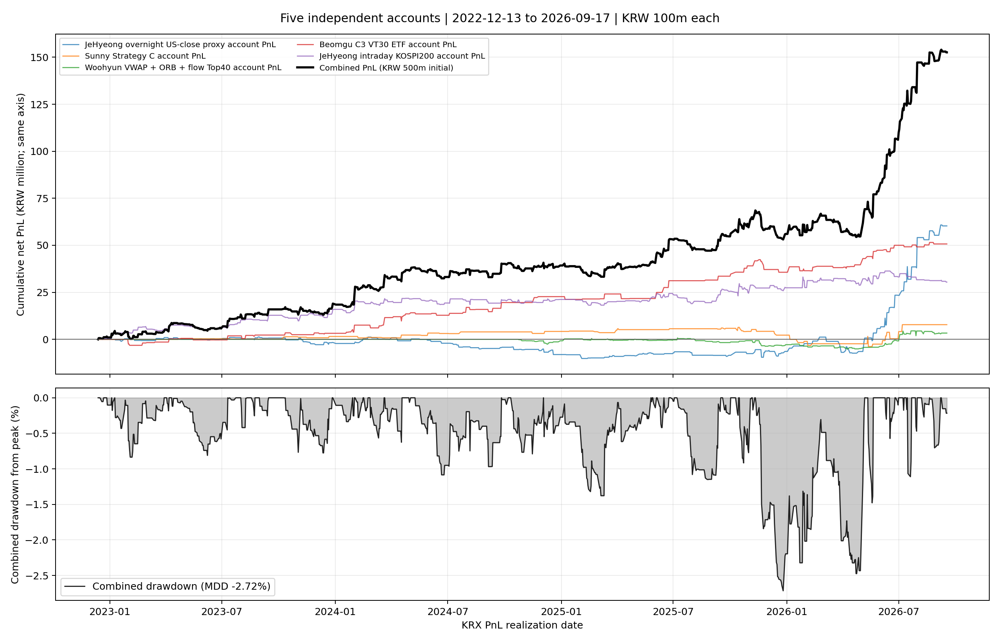

# 5개 전략 별도 계좌 통합 백테스트

평가기간 **2022-12-13~2026-09-17**, KRX 거래일 919일. 종료일은 5개 전략 자료가 공통으로 존재하는 가장 최근 손익 실현일이다.

각 계좌에 초기자본 1억 원을 각각 배정했다. 계좌는 각자 복리로 운용하고 자금을 이동하거나 매일 리밸런싱하지 않는다. 매일의 통합 자산은 다섯 계좌 자산의 합이며 통합 초기자본은 5억 원이다. 계좌 간 매수자금·포지션·체결은 독립적이고 현금일은 0% 수익이다. 수수료와 슬리피지를 포함한 순수익이다.

## 통합 성과

| 초기자본 | 최종자산 | 누적손익 | 누적수익률 | CAGR | MDD | Sharpe | 거래 수 |
|---:|---:|---:|---:|---:|---:|---:|---:|
| 500,000,000원 | 652,597,895원 | 152,597,895원 | 30.52% | 7.58% | -2.72% | 1.908 | 774 |

## 전략별 성과

| 전략 | 거래 수 | 누적수익률 | CAGR | MDD | Sharpe |
|---|---:|---:|---:|---:|---:|
| 제형: 미국 종가 보정 proxy | 191 | 60.31% | 13.82% | -11.30% | 1.087 |
| sunny: Strategy C | 56 | 7.81% | 2.08% | -9.61% | 0.370 |
| woohyun: VWAP+ORB+Top40, 30봉 | 149 | 3.33% | 0.90% | -5.99% | 0.253 |
| beomgu: C3·VT30·ETF | 100 | 50.71% | 11.91% | -4.71% | 1.721 |
| jehyeong: intraday final KOSPI200 | 278 | 30.43% | 7.56% | -4.35% | 0.929 |

## 해석 및 가정

- woohyun 전략은 외국인 수급의 250일 준비 기간 때문에 2024-10-10부터 신호가 가능하다. 그 전까지 계좌는 현금으로 두어 수익률 0%를 반영했다.
- jehyeong intraday는 최종 KOSPI200 롱온리·하루 1회 진입 전략의 저장된 일별 실현 손익을 사용했다. 유효 분봉 품질 검사를 통과하지 못한 날은 별도 계좌 현금일로 처리했다.
- 익일 청산 전략의 순손익은 청산일에 기록한다. 모든 계좌를 같은 KRX 거래일 달력에 맞추고, 해당 날짜에 거래가 없으면 수익률 0이다.
- Sharpe는 무위험수익률 0, 표본 일별 표준편차와 연 252거래일을 사용했다. CAGR도 252거래일 기준이다. MDD는 일별 손익 기준이므로 장중 미실현 낙폭은 포함하지 않는다.
- beomgu 전략은 확정된 당일 시가를 본 뒤 같은 시가에 체결하는 원 전략 가정을 포함한다. 실행 가능성보다 원 전략의 과거 결과 재현에 초점을 둔다.
- 전략별 손익의 상관관계와 동시 위험을 함께 반영하지만, 같은 시각 주문 충돌·시장충격·유동성 한도는 모델링하지 않는다. 별도 계좌라는 요청에 따라 자본 합산만 반영했다.
- 그래프 위 패널에는 개별 1억 원 계좌의 누적수익률(왼쪽 축)과 5억 원 통합 PnL(오른쪽 축)을 표시한다. 아래 패널은 통합 계좌의 일별 MDD다.

`portfolio_summary.csv`, `individual_strategy_summary.csv`, `portfolio_daily_pnl.csv`, `daily_returns_by_strategy.csv`, `equity_by_strategy.csv`, `trade_log.csv`, `provenance.json`은 결과 재현과 점검을 위한 파일이다.
