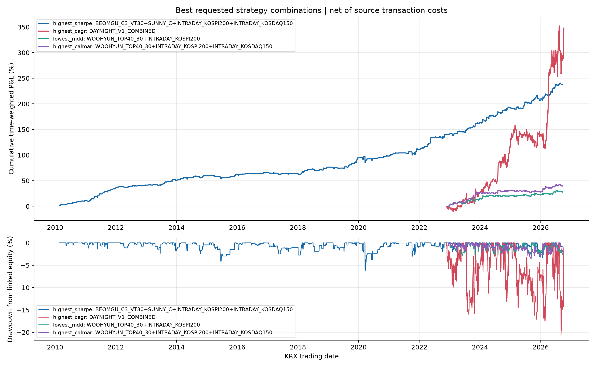

# 6개 요청 전략의 63개 조합 성과

서로 다른 데이터 준비 기간을 보존해 6개 전략의 모든 비어 있지 않은 조합(63개)을 계산했다. 각 전략은 별도의 동일 초기자본 계좌로 복리 운용하며, 전략 준비 전에는 조합에서 제외하고 준비일에 같은 규모의 신규 계좌를 추가한다. 조합 종료일은 포함된 전략 중 가장 이른 마지막 평가일이다.

성과는 계좌 간 현금 유입을 제거한 연결(time-weighted) 일별 수익률 기준이다. 실제 합산 P&L과 원화 비용·회전율도 CSV에 포함했다. 기존 결과에 비용이 반영되어 있는 경우 재차 차감하지 않았다.

## 목표별 최고 조합

| 목표 | 조합 | 구간 | CAGR | MDD | Sharpe | Calmar | 평균 일 회전율 | 총 수수료+슬리피지 |
|---|---|---|---:|---:|---:|---:|---:|---:|
| 최고 Sharpe | BEOMGU_C3_VT30+SUNNY_C+INTRADAY_KOSPI200+INTRADAY_KOSDAQ150 | 2010-02-22~2026-09-17 | 7.81% | -6.13% | 1.623 | 1.274 | 0.208x | 106,170,792원 |
| 최고 CAGR | DAYNIGHT_V1_COMBINED | 2022-11-23~2026-10-07 | 49.23% | -20.73% | 1.432 | 2.375 | 1.784x | 84,150,206원 |
| 최저 MDD | WOOHYUN_TOP40_30+INTRADAY_KOSPI200 | 2022-12-13~2026-09-23 | 6.91% | -2.89% | 1.075 | 2.391 | 0.589x | 23,275,383원 |
| 최고 Calmar | WOOHYUN_TOP40_30+INTRADAY_KOSPI200+INTRADAY_KOSDAQ150 | 2022-12-13~2026-09-23 | 9.53% | -3.53% | 1.357 | 2.704 | 0.824x | 56,282,634원 |



## 전략별 데이터 준비 구간

| 전략 | 첫 준비일 | 마지막 평가일 | 관측일 |
|---|---|---|---:|
| Beomgu r5 C3|vt30|ETF | 2010-02-22 | 2026-09-22 | 4,083 |
| Sunny Strategy C (pos_C) | 2010-03-31 | 2026-09-17 | 4,054 |
| Woohyun Flow Top40, 30 positive bars | 2024-10-10 | 2026-09-23 | 478 |
| JeHyeong daynight V1 combined | 2022-11-23 | 2026-10-07 | 944 |
| JeHyeong intraday KOSPI200 | 2022-12-13 | 2026-10-07 | 862 |
| JeHyeong intraday KOSDAQ150 | 2022-12-13 | 2026-10-07 | 881 |

## 전체 조합 성과표

`all_combinations_performance.csv`에 63개 전체 조합의 CAGR, MDD, Sharpe, Calmar, 거래회전율, 거래비용이 수록되어 있다. 조합 간 기간이 다르므로 순위는 각 조합이 실제로 관측 가능한 전체 기간에서 계산했다.

## 자본·산식·비용 가정

- 각 전략 계좌 초기자본: 100,000,000원. 기존 계좌는 독립 복리 운용하며 계좌 사이에 주문·자금 이동·상계가 없다.
- 계좌는 첫 유효 준비일에 시작한다. 준비일에 추가되는 계좌 자본은 현금유입으로 처리하고, CAGR/Sharpe/MDD는 연결 수익률로 계산해 유입금이 수익이나 고점으로 오인되지 않게 했다.
- 조합 마지막 날은 해당 조합 전략의 마지막 가용일 중 가장 빠른 날짜다. 이 날짜 이후 전략의 손익을 외삽하지 않는다.
- Sharpe는 무위험수익률 0, 일별 표본 표준편차, 연 252 거래일을 쓴다. CAGR은 연결 자산의 252/관측 세션 수 연율화, Calmar=CAGR/|MDD|다.
- turnover는 매수+매도 거래대금/해당일 운용 NAV다. 거래 로그만 보유한 당일 전략은 거래금액 비중의 양방향 합계로 재구성했다.
- 비용은 원 전략 결과의 순수익과 기록된 주문 비용을 사용한다. Sunny는 원 코드의 왕복 3bp, Woohyun/Beomgu는 기존 감사 결과의 3bp 수수료+2bp 슬리피지, daynight/intraday는 저장 결과의 편도 1.5bp+1bp를 따른다.
- 모든 순수익은 원자료의 선택된 고정전략 결과다. 조합 성과를 보고 개별 전략의 임계값이나 설정을 다시 최적화하지 않았다. 다만 63개 중 목표별 최고를 고르는 과정 자체는 동일 표본 내 선택이므로 표본외 성과 보장은 아니다.
- Beomgu C3는 확정 시가를 보고 같은 시가 체결하는 원 전략 가정을 유지한다. Woohyun은 첫 ORB 신호 뒤 30개의 양의 거래량 봉을 기준으로 한 기존 선정 거래를 사용한다. intraday는 저장된 final KOSPI/KOSDAQ 규칙 결과다.

## 재현

```bash
python3 jehyeong/overnight/combine_requested_six_strategies.py
```

산출물: `report.html` (전체 HTML 보고서 및 daynight V1 조합 표), `daynight_v1_combinations.csv`, `all_combinations_performance.csv`, `all_combinations_daily_pnl.csv`, `best_combinations.csv`, `best_combinations_daily_pnl.csv`, `best_combinations_pnl.png`, `strategy_coverage.csv`, `manifest.json`.
