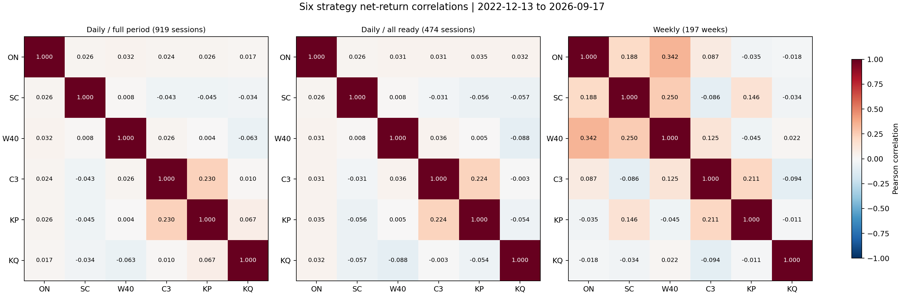

# 6개 전략 알파 풀 상관관계와 조합 분석

2022-12-13~2026-09-17, 919 KRX 거래일의 **거래비용 차감 후 일별 계좌 순수익률**로 계산했다. 미거래일은 0이며 누적 PnL 곡선의 상관을 계산한 것이 아니다.

| 코드 | 전략 |
|---|---|
| ON | 제형: 미국 종가 보정 proxy |
| SC | sunny: Strategy C |
| W40 | woohyun: VWAP+ORB+Top40, 30봉 |
| C3 | beomgu: C3·VT30·ETF |
| KP | jehyeong: intraday final KOSPI200 |
| KQ | jehyeong: intraday final KOSDAQ150 |

## 일별 Pearson 상관

| 전략 | ON | SC | W40 | C3 | KP | KQ |
|---|---:|---:|---:|---:|---:|---:|
| ON | 1.000 | 0.026 | 0.032 | 0.024 | 0.026 | 0.017 |
| SC | 0.026 | 1.000 | 0.008 | -0.043 | -0.045 | -0.034 |
| W40 | 0.032 | 0.008 | 1.000 | 0.026 | 0.004 | -0.063 |
| C3 | 0.024 | -0.043 | 0.026 | 1.000 | 0.230 | 0.010 |
| KP | 0.026 | -0.045 | 0.004 | 0.230 | 1.000 | 0.067 |
| KQ | 0.017 | -0.034 | -0.063 | 0.010 | 0.067 | 1.000 |

## 상관계수 해석

- C3와 KP는 전체 일별 상관 0.230, 공통 준비기간 0.224다. 둘 다 손익이 발생한 57일의 조건부 상관은 0.727로 높다. 동일 코스피 장중 롱 성격이므로 서로 완전히 다른 알파로 보기는 어렵다.
- ON과 C3, ON과 KQ, C3와 KQ의 전체 일별 상관은 각각 0.024, 0.017, 0.010이다. 관측 손익 기준으로 수익성 있는 전략 중 서로 덜 겹치는 조합이다.
- ON과 W40은 일별 0.032이지만 주별 0.342다. SC와 W40도 주별 0.250이다. 모든 거래일의 일별 0 근처 값만으로 직교성을 판단하면 일부 같은 시기 수익/손실을 놓친다.
- SC와 KP의 동시 손익 발생일 상관은 -0.884지만 표본은 12일뿐이다. SC와 C3, SC와 W40은 각각 5일이다. 이러한 작은 조건부 표본을 강한 헤지 근거로 사용하지 않는다.
- W40의 2024-10-10 전 현금 구간을 제외한 474일 분석도 따로 계산했다. KP와 KQ 상관은 전체 0.067, 이 구간 -0.054이므로 상관은 기간에 따라 변한다.

## 전략별 수익성과 활동일

| 전략 | CAGR | MDD | Sharpe | 손익 발생일 | 평균 절대 일별 상관 |
|---|---:|---:|---:|---:|---:|
| ON | 13.82% | -11.30% | 1.087 | 191 | 0.025 |
| SC | 2.08% | -9.61% | 0.370 | 56 | 0.031 |
| W40 | 0.90% | -5.99% | 0.253 | 149 | 0.027 |
| C3 | 11.91% | -4.71% | 1.721 | 100 | 0.067 |
| KP | 7.56% | -4.35% | 0.929 | 278 | 0.075 |
| KQ | 12.56% | -9.07% | 1.015 | 532 | 0.038 |

## 동등 초기자본 조합 비교

각 전략 계좌는 각자 복리 운용하고 계좌간 자금 이동을 하지 않는다. 모든 조합은 전체 초기자본으로 정규화하여 비교했다. 전략을 제외한 계좌의 초기자본을 남은 전략에 동일하게 배분하는 비교이므로 같은 자본이 투자되는 경우의 효과다.

| 구성 | CAGR | MDD | Sharpe | Calmar | 평균 절대 일별 상관 |
|---|---:|---:|---:|---:|---:|
| ON+SC+W40+C3+KP+KQ | 8.45% | -2.64% | 2.052 | 3.198 | 0.044 |
| ON+SC+C3+KP+KQ | 9.80% | -2.96% | 2.045 | 3.315 | 0.052 |
| ON+C3+KP+KQ | 11.53% | -3.50% | 2.009 | 3.290 | 0.063 |
| ON+C3+KQ | 12.77% | -4.85% | 1.908 | 2.635 | 0.017 |
| C3+KP+KQ | 10.73% | -2.44% | 1.749 | 4.407 | 0.102 |
| ON+C3 | 12.87% | -3.74% | 1.807 | 3.438 | 0.024 |

## 운용 후보 해석

직교성과 수익성을 우선하면 **ON+C3+KQ**를 핵심 검토 후보로 삼을 수 있다. 세 전략의 일별 상관이 모두 낮고 개별 CAGR가 높다. 다만 세 계좌 조합의 MDD는 6계좌보다 크므로 같은 위험에서 더 높은 수익을 입증한 것은 아니다.

더 간단한 **ON+C3**는 CAGR 12.87%, MDD 3.74%, Sharpe 1.807이다. KQ를 추가하면 Sharpe는 1.908로 높아지지만 MDD는 4.85%로 커지고 CAGR는 12.77%가 된다. KQ가 추가될 때 모든 위험 지표가 좋아지는 것은 아니다.

낙폭과 Sharpe를 더 중시하면 **ON+C3+KP+KQ**를 비교한다. KP는 C3와 동시 거래 손익이 많이 겹치지만 이 표본에서는 전체 조합의 낙폭을 낮췄다. 신호 발생시점·동시 코스피 노출 제한을 다음 검토 대상으로 삼을 수 있다.

**SC와 W40은 저상관이어도 낮은 수익성이 약점**이다. W40을 제외한 5전략은 CAGR와 Calmar가 높아지며 Sharpe는 6전략과 거의 같다. SC 역시 낮은 수익과 비용 부담을 점검할 후보다. 다만 6전략은 전체 63조합 중 과거 전체기간 Sharpe가 가장 높아, 두 전략을 무조건 무가치하다고 판단해서는 안 된다.

Calmar만으로 사후 고르면 C3+KP+KQ가 높지만 C3/KP의 조건부 상관이 크다. 63조합의 최고값은 같은 자료에서 골랐으므로 독립 미관찰 기간 성과가 아니다. 가중치 최적화는 수행하지 않았다.

## 계산의 범위

- ON 손익은 익일 청산일에 기록하고 장중 전략은 당일 기록한다. 자본 합산의 일별 위험을 보는 데 적합하지만 실제 같은 시간의 시장 노출 독립성을 보장하지 않는다. 주별 상관은 기록 시점의 영향을 일부 완화한다.
- 활동일은 절대 일별 순수익률이 1e-12보다 큰 날이다. 동시 손익 발생일 상관은 해당 부분표본에 조건을 건 값이므로 전체 위험 상관과 서로 다른 통계다.
- pair_diagnostics.csv의 95% 구간은 20거래일 연속 블록을 1,000회 재추출한 관측자료 상관 구간이다. 미래 국면에서 상관이 유지된다는 보장은 아니다.
- 구간별 성과는 기존 계좌 수익률을 구간 시작에서 재정규화한 분석이며 구간 전 진입의 청산 손익이 포함될 수 있다. 사전 규칙을 동결한 독립 검증으로 취급하지 않는다.
- 원 전략의 시가 신호/동일 시가 체결 가정(C3), 선물 proxy(SC), 분봉 제외일의 현금 처리 등 기존 백테스트 제약을 그대로 물려받는다.

전체 상관 CSV, 주별/공통기간/Spearman 행렬, 동시 손익일·손실 겹침·bootstrap 구간, 개별 성과, 전략 하나씩 제외한 결과, 63개 동등 초기자본 조합과 후보의 연도별 지표를 함께 저장했다.
