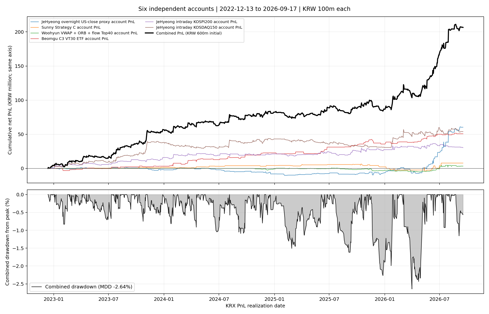

# 6개 전략 독립 계좌 통합 성과

5개 전략 비교의 같은 기간인 **2022-12-13~2026-09-17 (919 KRX 거래일)**에 jehyeong intraday final KOSDAQ150 전략을 초기자본 1억 원의 여섯 번째 독립 계좌로 추가했다.

각 계좌 자산은 계좌별로 별도 복리 계산하고, 매일 여섯 자산을 합산했다. 계좌간 자금 이동과 매일 리밸런싱은 없다. 비용이 반영된 기존 일별 손익을 사용해 중복 차감하지 않았다.

| 기간 | 거래일 | 초기자본 | 최종자산 | 누적손익 | 누적수익률 | CAGR | MDD | Sharpe | 거래 수 |
|---|---:|---:|---:|---:|---:|---:|---:|---:|---:|
| 2022-12-13~2026-09-17 | 919 | 600,000,000원 | 806,554,460원 | 206,554,460원 | 34.43% | 8.45% | -2.64% | 2.052 | 1,306 |

상단의 개별 PnL과 통합 PnL은 모두 원화 기준 같은 세로축을 사용한다. 계좌별 손익과 합산 손익은 시작일 0원에서 출발한다.

코스닥 계좌는 KODEX 코스닥150 신호와 기존 최종 코스닥 전략의 1분 보호청산을 그대로 사용했다. 왕복 수수료 3bp와 슬리피지 2bp가 반영된 순손익이다. MDD는 일별 손익 기준이며 장중 미실현 낙폭은 포함하지 않는다.

| 산출물 | 내용 |
|---|---|
| `portfolio_summary.csv` | 6계좌 통합 성과 지표 |
| `portfolio_daily_pnl.csv` | 날짜별 통합 순수익, 자산, 손익, 낙폭 |
| `equity_by_strategy.csv` | 6개 개별 계좌 자산 배수 |
| `daily_returns_by_strategy.csv` | 6개 개별 계좌 일별 순수익 |
| `provenance.json` | 사용 기간, 계좌 규칙, 데이터 SHA256 |
