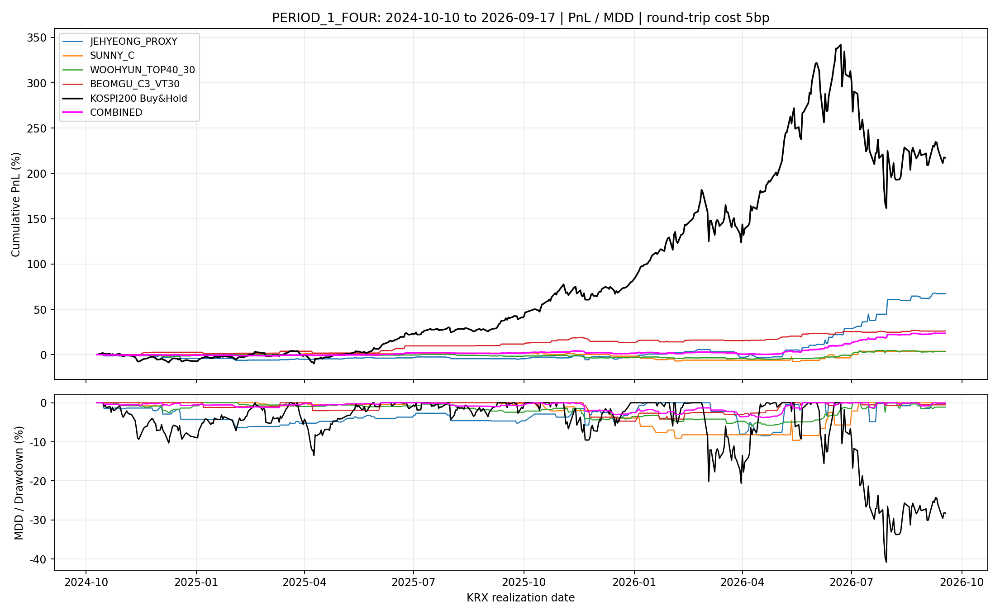
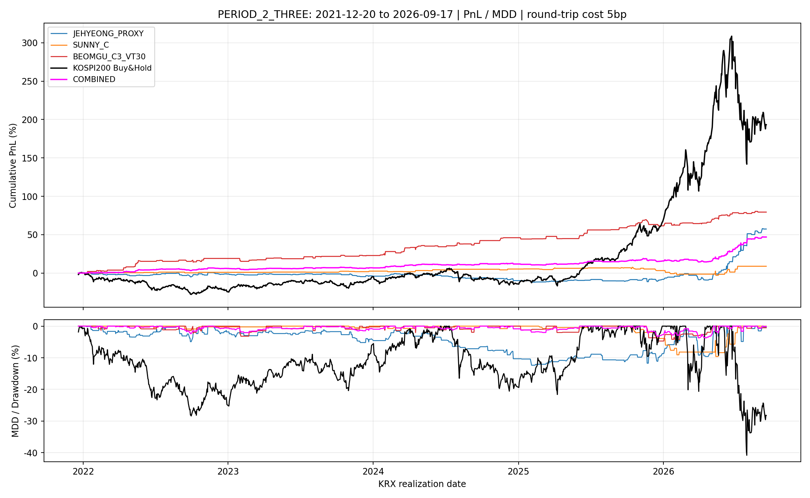

# 커밋된 전략의 공통 기간·별도 계좌 비교

## 결과

각 계좌의 초기자산을 1로 놓고 독립적으로 복리 운용했다. 아래 수치는 왕복 수수료 3bp와 슬리피지 2bp를 차감한 결과다. 전략을 합친 포트폴리오 성과는 계산하지 않았다.

### 1기간: 4개 전략 (2024-10-10~2026-09-17, 474 KRX 거래일)

| 전략 | 평가기간 | 거래 | 누적수익률 | CAGR | MDD | Sharpe | Calmar |
|---|---|---:|---:|---:|---:|---:|---:|
| 제형: 미국 종가 보정 proxy | 2024-10-10~2026-09-17 | 104 | 67.34% | 31.49% | -8.45% | 1.688 | 3.725 |
| sunny: Strategy C | 2024-10-10~2026-09-17 | 39 | 3.71% | 1.95% | -9.61% | 0.276 | 0.203 |
| woohyun: VWAP+ORB+Top40, 30봉 | 2024-10-10~2026-09-17 | 149 | 3.33% | 1.76% | -5.99% | 0.352 | 0.293 |
| beomgu: C3·VT30·ETF | 2024-10-10~2026-09-17 | 54 | 26.05% | 13.10% | -4.71% | 1.895 | 2.782 |

### 2기간: 3개 전략 (2021-12-20~2026-09-17, 1161 KRX 거래일)

| 전략 | 평가기간 | 거래 | 누적수익률 | CAGR | MDD | Sharpe | Calmar |
|---|---|---:|---:|---:|---:|---:|---:|
| 제형: 미국 종가 보정 proxy | 2021-12-20~2026-09-17 | 244 | 57.42% | 10.35% | -12.35% | 0.905 | 0.838 |
| sunny: Strategy C | 2021-12-20~2026-09-17 | 64 | 8.92% | 1.87% | -9.61% | 0.367 | 0.195 |
| beomgu: C3·VT30·ETF | 2021-12-20~2026-09-17 | 136 | 79.47% | 13.53% | -4.71% | 1.870 | 2.875 |

## 동일자본으로 4/3개 전략을 종합한 성과

각 전략 계좌에 동일한 초기자본을 배정하고, 매 평가일의 전략별 순수익률을 산술평균해 종합 계좌의 수익률을 계산했다. 따라서 각 전략의 수익률이 같은 비중으로 반영되며, 개별 계좌의 거래금액을 합친 뒤 다시 초기 총자본으로 나누는 방식과 같다.

| 전략 | 평가기간 | 거래 | 누적수익률 | CAGR | MDD | Sharpe | Calmar |
|---|---|---:|---:|---:|---:|---:|---:|
| 동일자본 종합 (4개) | 2024-10-10~2026-09-17 | 346 | 23.52% | 11.88% | -3.76% | 2.141 | 3.157 |
| 동일자본 종합 (3개) | 2021-12-20~2026-09-17 | 444 | 46.99% | 8.72% | -3.69% | 1.731 | 2.366 |

### 성과 해석

1기간에서는 제형 proxy가 CAGR·Calmar가 높고, beomgu는 Sharpe가 더 높으며 MDD가 작다. 2기간에서는 beomgu가 CAGR·Sharpe·Calmar 모두 높다. 제형 proxy는 장기 구간에 비해 최근 구간 성과가 강해 기간 선택에 민감하다. 장기 연도별 표에서 2022년을 포함한 수익 분포를 확인할 수 있다.
제형 proxy는 2022~2024년 각각 −1.22%, −2.25%, −6.54%였고, 2025년 +1.82%, 2026년은 공통 종료일까지 +71.32%다. 장기 수익의 상당 부분이 마지막 연도에 집중되어 있다.
woohyun의 기존 README 평균 총수익은 거래당 약 6.93bp이다. 요청한 5bp 비용을 차감하고 미거래일을 포함하여 공통 기간에서 다시 계산하므로 비용 없는 기존 Sharpe와 차이가 크다. 전략의 매매 대상·방향·비중·신호 시각은 서로 다르며, beomgu에는 아래의 시가 신호·시가 체결 가정이 포함된다. 이 표는 고정된 각 전략의 계좌 성과 비교이며 같은 위험이나 실행 가능성을 보장하는 비교는 아니다.

그래프의 검은색 선은 비용을 차감하지 않은 KOSPI200 buy-and-hold(069500 close-to-close), 자홍색 선은 동일자본 전략 결합 계좌다. 위 패널은 누적 PnL, 아래 패널은 각 곡선의 고점 대비 drawdown이다.

## 왜 이 기간인가

- 우현 수급 파일은 2023-09-25부터 있으나, 전일 수급의 상위 40% 기준에 과거 250일이 필요하여 첫 유효일은 2024-10-10이다. 번인 기간을 현금 운용 기간으로 늘려 성과를 계산하지 않았다.
- 장기 구간은 proxy_panel.csv가 시작하는 2021-12-20부터다. 2022년 전체를 포함하면서 최대 겹침을 사용했다.
- sunny의 커밋된 가격 파일이 2026-09-17까지여서 두 기간의 공통 종료일은 2026-09-17이다. 그 이후의 가격으로 자료를 확장하지 않았다. 해당 지수 파일의 마지막 행은 원 저자 코드에 장중 스냅샷 가능성이 언급되어 있다.

| 전략 | 계산 가능한 첫 신호일 | 마지막 신호일 | 비교 가능한 마지막 손익일 |
|---|---|---|---|
| 제형: 미국 종가 보정 proxy | 2021-12-20 | 2026-09-23 | 2026-09-28 |
| sunny: Strategy C | 2010-03-31 | 2026-09-17 | 2026-09-17 |
| woohyun: VWAP+ORB+Top40, 30봉 | 2024-10-10 | 2026-09-23 | 2026-09-23 |
| beomgu: C3·VT30·ETF | 2010-02-22 | 2026-09-22 | 2026-09-22 |

## 전략별 규칙

### 제형: 미국 종가 기준 보정 proxy

QQQ proxy 304940·SPY proxy 219480의 당일 15:20까지 실제 가격으로 계산한다. E0는 직전 한국장 종가, E1은 오늘 15:20 가격, A는 직전 한국장 종가 당시 알려진 미국 종가, B는 오늘 15:20 당시 알려진 미국 종가다. `log(E1/E0) − log(B/A)`가 두 ETF 모두 > 0이고, KRX_foreign.xlsx의 직전 실제 한국 거래일 외국인 순매수 > 0이면 KODEX200 당일 종가 매수·다음 한국 거래일 시가 매도한다. 자본 100% 롱이다.
미국 현지 세션 날짜와 뉴욕 16:00→한국 시간 변환, 서머타임·한미 휴일을 반영한다. 보정 지표는 기존 관측 PREUS의 근사이며 ETF 추적 차이·직전 한국 종가 시점의 괴리 잔차가 남는다.

### sunny: 최신 Strategy C의 case C

`sunny/intraday_strategy_C/strategy3_smart_vs_dumb.py`의 핵심 case C를 사용한다. 옵션 순매수 금액의 60일 rolling z-score를 하루 lag한다. 전일 외국인 풋 z > 1이고 개인 콜 z > 0이면 KOSPI200 당일 시가에 자본 대비 1배 숏, 당일 종가 청산한다. 다른 case A/B/D는 포함하지 않았다.
원 전략의 KOSPI200 지수 open-to-close를 선물 수익률 proxy로 사용한다. 실제 선물 가격·증거금·베이시스·롤 비용은 별도 모델링하지 않았다.

### woohyun: VWAP + ORB + Flow Top40, 30 설정

전일 외국인 선물 `(매수−매도)/(매수+매도)`가 그 이전까지의 250일 rolling 60% 분위 이상인 날에만 거래한다. 09:01~09:10의 opening range 고가보다 높고 누적 VWAP보다 높은 첫 종가를 09:11 이후 찾는다. 신호 다음 유효 봉의 시가로 KODEX200 자본 100% 롱, 진입 인덱스 +30 봉 종가로 청산한다. 하루 최대 한 거래다.
README에서 강조한 30 설정을 고정했으며 비교 성과로 보유시간을 고르지 않았다. 원 코드가 거래량 0 봉을 제거하므로 **30 설정은 30개의 유효 봉 인덱스 차이이며 정확히 30분 뒤 주문은 아니다**. 진입 봉부터 청산 봉까지 양쪽을 포함하면 31개 봉이며, 누락 봉이 있으면 시간은 더 길어진다. 이 동작을 그대로 유지했다.

수능일·연초처럼 장이 늦게 열려 09:01~09:10 자료가 없는 날에는 원 코드대로 거래하지 않는다. 자료가 존재하는 평가일이므로 그날을 삭제하지 않고 현금 수익률 0으로 포함한다.

### beomgu: r5_c3_levered의 C3|vt30|ETF

미국 S&P500 수익으로 설명한 KOSPI200 시가 갭의 회귀 잔차 z ≥ 1이며, `log(KODEX 시가/지수 시가)`가 직전 5일 종가 비율 로그의 중앙값 이하이면 C3 롱 신호다. 회귀는 당일을 뺀 과거 250행(최소 200 유효행)으로 계산한다. 전일까지만의 20일 지수 종가 수익률 변동성 σ에 대해 `w=C3×clip(0.30/σ,0,2)`를 적용한다.
w≤1이면 KODEX200 비중 w와 현금 1−w, 1<w≤2이면 KODEX200 비중 2−w 및 실제 KODEX 레버리지 122630 비중 w−1이다. 당일 시가→종가 수익률을 각 비중으로 합친다. 전체 구간에 실제 레버리지 ETF 자료가 있어 2배 합성 수익률을 쓰지 않는다.
**당일 09:00 시가를 보고 신호를 계산하면서 같은 09:00 시가 단일가에 체결하는 가정이다. 체결 이후 알게 되는 확정 시가를 같은 시가 체결에 사용하므로 실제 실행보다 유리할 수 있다.** 이는 커밋된 주 전략의 가정을 유지한 비교이며, 실제 주문 가능한 성과 검증과 구분해야 한다. 최종 선택 C3|vt30|ETF를 고정하고 비교 기간에서 42개 후보를 다시 선택하지 않았다.

## 비용·계좌·성과 계산 규약

- 제형·sunny·woohyun은 한 번 거래할 때 계좌 대비 1배 거래금액에 왕복 5bp를 한 번 차감한다. 기존 순수익에 비용을 중복 차감하지 않고 각 원자료 총수익에서 다시 계산한다.
- beomgu는 실제 매매하는 두 ETF의 **자본 비중 합**에 각각 수수료 3bp·슬리피지 2bp를 적용한다. 레버리지 ETF에 전액 투자하여 지수 노출이 2배여도 현금 거래금액은 자본의 1배라 5bp다. w<1일 때 비용도 w에 비례한다.
- 각 전략은 별도 계좌·자본 1로 시작한다. 계좌 간 신호, 포지션, 거래 순서, 주문을 합치지 않는다. 장중 주문 혼잡이나 전략 간 체결 경쟁은 없다고 가정한다.
- 모든 KRX 평가 거래일을 유지하고 미거래일은 수익률 0이다. 장중·오버나이트를 같은 달력으로 비교하도록 손익·왕복 비용을 **청산일**에 기록한다. 제형 전략의 진입일과 청산일은 거래장부에서 별도로 확인할 수 있다.
- 시작일 전에 들어간 포지션 및 종료일 후에 청산하는 거래를 제외한다. 종료일의 신규 오버나이트 진입은 비교 성과에 포함하지 않는다.
- 모든 신호·rolling window는 전체 과거 자료로 계산한 뒤 평가 구간을 자른다. 구간 시작에서 번인을 다시 하지 않는다. 자료가 없는 날에 미래·전일 가격을 채우지 않고 신규 진입하지 않는다.
- CAGR = 최종자산^(252/N)−1. N은 공통 KRX 거래일 수다. Sharpe = 일별 순수익률 평균 / 표본 표준편차 ×√252, 무위험수익률 0. MDD = 초기자산 1을 포함한 고점 대비 최대 하락률. Calmar = CAGR/|MDD|. 오버나이트의 장중 미실현 낙폭은 일별 청산 손익 MDD에 들어가지 않는다.
- sunny 원 보고서의 CAGR/연변동성 방식 및 woohyun의 거래일만으로 산출한 Sharpe는 재사용하지 않았다. 모두 위의 동일한 일별 계좌 정의로 다시 계산했으므로 기존 폴더의 요약 숫자와 다를 수 있다.

## 결측·원본 대조

| 기간 | 전략 | 신호 자료 없는 평가일 수 | 해당 날짜 |
|---|---|---:|---|
| PERIOD_1_FOUR | 제형: 미국 종가 보정 proxy | 0 | 없음 |
| PERIOD_1_FOUR | sunny: Strategy C | 0 | 없음 |
| PERIOD_1_FOUR | woohyun: VWAP+ORB+Top40, 30봉 | 0 | 없음 |
| PERIOD_1_FOUR | beomgu: C3·VT30·ETF | 0 | 없음 |
| PERIOD_2_THREE | 제형: 미국 종가 보정 proxy | 1 | 2023-09-25 |
| PERIOD_2_THREE | sunny: Strategy C | 0 | 없음 |
| PERIOD_2_THREE | beomgu: C3·VT30·ETF | 0 | 없음 |

제형의 자료 유무는 진입일 기준이다. 구간 끝 신규 진입 불가와는 별개다. peer source 함수의 순수익과 새 거래장부를 대조했고, beomgu의 저장된 w_chosen·net5_chosen도 수치 오차 1e−7 이내로 일치했다. 우현은 커밋된 자료 준비 및 진입·청산 함수를 직접 실행했다.

## 연도별 공통 계좌 순수익

| 기간 | 연도 | 전략 | 순수익률 | 거래 |
|---|---:|---|---:|---:|
| PERIOD_1_FOUR | 2024 | 제형: 미국 종가 보정 proxy | -4.07% | 13 |
| PERIOD_1_FOUR | 2025 | 제형: 미국 종가 보정 proxy | 1.82% | 45 |
| PERIOD_1_FOUR | 2026 | 제형: 미국 종가 보정 proxy | 71.32% | 46 |
| PERIOD_1_FOUR | 2024 | sunny: Strategy C | 0.25% | 2 |
| PERIOD_1_FOUR | 2025 | sunny: Strategy C | -1.91% | 22 |
| PERIOD_1_FOUR | 2026 | sunny: Strategy C | 5.46% | 15 |
| PERIOD_1_FOUR | 2024 | woohyun: VWAP+ORB+Top40, 30봉 | -0.77% | 16 |
| PERIOD_1_FOUR | 2025 | woohyun: VWAP+ORB+Top40, 30봉 | -2.08% | 76 |
| PERIOD_1_FOUR | 2026 | woohyun: VWAP+ORB+Top40, 30봉 | 6.35% | 57 |
| PERIOD_1_FOUR | 2024 | beomgu: C3·VT30·ETF | 2.63% | 2 |
| PERIOD_1_FOUR | 2025 | beomgu: C3·VT30·ETF | 10.56% | 21 |
| PERIOD_1_FOUR | 2026 | beomgu: C3·VT30·ETF | 11.09% | 31 |
| PERIOD_2_THREE | 2021 | 제형: 미국 종가 보정 proxy | 0.00% | 0 |
| PERIOD_2_THREE | 2022 | 제형: 미국 종가 보정 proxy | -1.22% | 57 |
| PERIOD_2_THREE | 2023 | 제형: 미국 종가 보정 proxy | -2.25% | 52 |
| PERIOD_2_THREE | 2024 | 제형: 미국 종가 보정 proxy | -6.54% | 44 |
| PERIOD_2_THREE | 2025 | 제형: 미국 종가 보정 proxy | 1.82% | 45 |
| PERIOD_2_THREE | 2026 | 제형: 미국 종가 보정 proxy | 71.32% | 46 |
| PERIOD_2_THREE | 2021 | sunny: Strategy C | 0.00% | 0 |
| PERIOD_2_THREE | 2022 | sunny: Strategy C | 1.04% | 8 |
| PERIOD_2_THREE | 2023 | sunny: Strategy C | 1.53% | 8 |
| PERIOD_2_THREE | 2024 | sunny: Strategy C | 2.64% | 11 |
| PERIOD_2_THREE | 2025 | sunny: Strategy C | -1.91% | 22 |
| PERIOD_2_THREE | 2026 | sunny: Strategy C | 5.46% | 15 |
| PERIOD_2_THREE | 2021 | beomgu: C3·VT30·ETF | 0.27% | 1 |
| PERIOD_2_THREE | 2022 | beomgu: C3·VT30·ETF | 18.76% | 35 |
| PERIOD_2_THREE | 2023 | beomgu: C3·VT30·ETF | 3.21% | 19 |
| PERIOD_2_THREE | 2024 | beomgu: C3·VT30·ETF | 18.90% | 29 |
| PERIOD_2_THREE | 2025 | beomgu: C3·VT30·ETF | 10.56% | 21 |
| PERIOD_2_THREE | 2026 | beomgu: C3·VT30·ETF | 11.09% | 31 |

연도별 수치는 기간 내 일부 연도도 포함하며 연환산하지 않았다.

## 커밋·재현

| 전략 | 커밋 | 커밋 시각 |
|---|---|---|
| sunny: Strategy C | `27cc4f6cd507aa9659240d6c2dc73cffea130ae1` | 2026-10-06T15:58:48+09:00 |
| woohyun: VWAP+ORB+Top40, 30봉 | `40294f90f209b05ccbb8ab58727db919a2733896` | 2026-10-01T00:45:21+09:00 |
| beomgu: C3·VT30·ETF | `0011357f9ded494fe67e04f41acd340f380cb772` | 2026-10-05T22:28:44+09:00 |

peer 전략은 해당 파일의 최신 커밋 내용을 Git에서 읽었다. 로컬 우현 파일의 경로 수정은 신호 규칙으로 사용하지 않았다. 우현의 커밋된 코드에 적힌 입력 파일명만 현재 저장소의 실제 파일 경로로 연결했다. peer 코드와 원자료를 수정하지 않는다.
제형의 보정 proxy 구현 및 사용 데이터·helper 코드의 SHA256, 라이브러리 버전·체크 결과는 provenance.json에 저장했다.

```powershell
python jehyeong/f1_f2_f3_minute_eda_aligned_causal.py
python jehyeong/compare_committed_strategies.py
python -m unittest discover -s jehyeong/tests -v
```





summary.csv: 개별 전략 지표 / portfolio_summary.csv: 동일자본 종합 지표 / 각 period_*_daily_returns.csv: 공통 달력 손익 / period_trade_log.csv: 실제 평가에 포함한 거래 / all_strategy_trade_log.csv: 전체 자료 거래 / 각 *_signal_panel.csv: 신호·비중 감사 / coverage.csv·provenance.json: 재현 정보.
