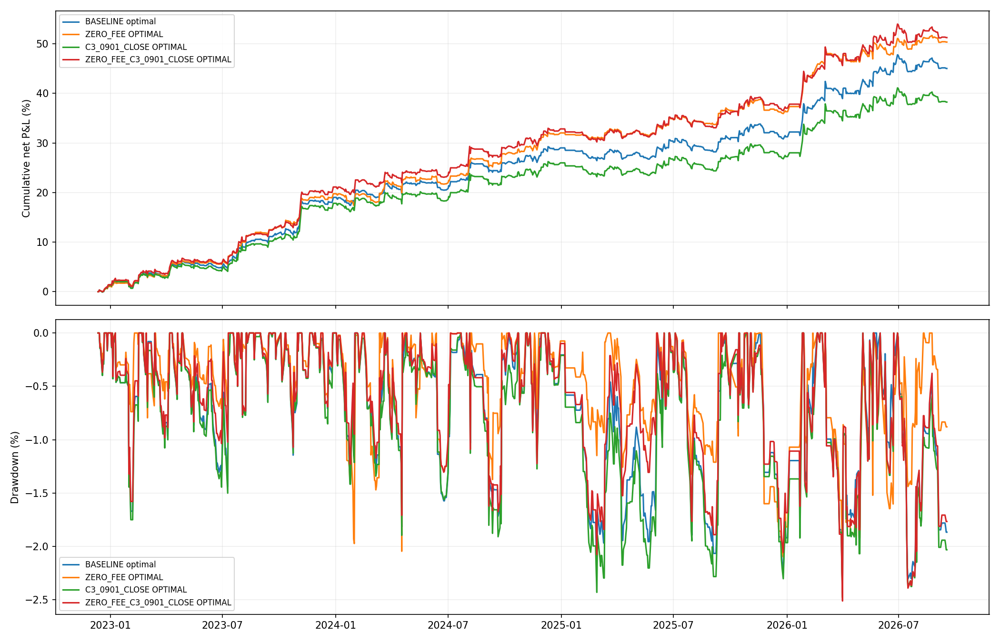

# 수수료 및 C3 09:01 종가 체결 민감도

평가 2022-12-13~2026-09-17, 919거래일. 기존 33개 후보·13개 그룹, 같은 신호 비중 한 버전, KP·KD 선택 가능, 2계좌 이상 전체 조합을 각 시나리오에서 다시 검색했다. 초기자본 동일, 계좌별 복리 자산 합산, 계좌 간 리밸런싱 없음.

수수료만 왕복 3bp에서 0bp로 변경한다. 슬리피지는 모든 경우 왕복 2bp 유지. KP·KD는 frozen 거래일·규칙으로 주문 수량과 매수·매도 수수료를 다시 계산했고, 원래 비용의 일별 수익이 기존 결과와 일치하는지 확인했다. 원본 데이터와 기존 결과는 보존했다.

C3는 원래 시가 신호 및 진입비중을 그대로 고정하고, ETF 진입가격만 09:01 bar_end close(09:00~09:01 종가)로 변경했다. 청산은 기존 일봉 close. 지연 시점에 신호를 재판단하지 않는다. 정확한 09:01 가격이 없으면 미체결로 현금 보유한다. 기본 시나리오는 양의 거래량을 요구하며, ZERO_VOLUME_PRICE 보조 시나리오는 거래량 0이라도 CSV 표시가격 체결을 허용한다. 실제 주문은 체결 보장이 없으며 지수 시가의 실제 공표 지연까지 검증한 결과는 아니다.

| scenario | selection | members | accounts | CAGR | MDD | Sharpe | Calmar | same_as_baseline |
| --- | --- | --- | --- | --- | --- | --- | --- | --- |
| BASELINE | OPTIMAL | C3_KOSPI_KOSPI_SIGNAL_VT30;KP;KD | 3 | 10.73% | -2.44% | 1.7489697118302017 | 4.406770644654833 | True |
| ZERO_FEE | OPTIMAL | C3_KOSPI_KOSPI_SIGNAL_VT30;C3_KOSDAQ_KOSPI_SIGNAL_VT30;KP;KD | 4 | 11.83% | -2.10% | 2.0952487224664744 | 5.6414268344016465 | False |
| ZERO_FEE | BASELINE_MEMBERS | C3_KOSPI_KOSPI_SIGNAL_VT30;KP;KD | 3 | 13.41% | -2.47% | 2.1145655012515205 | 5.432284108412771 | True |
| C3_0901_CLOSE | OPTIMAL | C3_KOSPI_KOSPI_SIGNAL_VT30;KP;KD | 3 | 9.29% | -2.48% | 1.5077093068657201 | 3.746399378960452 | True |
| C3_0901_CLOSE | BASELINE_MEMBERS | C3_KOSPI_KOSPI_SIGNAL_VT30;KP;KD | 3 | 9.29% | -2.48% | 1.5077093068657201 | 3.746399378960452 | True |
| ZERO_FEE_C3_0901_CLOSE | OPTIMAL | C3_KOSPI_KOSPI_SIGNAL_VT30;KP;KD | 3 | 12.02% | -2.51% | 1.8855967770146396 | 4.786235746532413 | True |
| ZERO_FEE_C3_0901_CLOSE | BASELINE_MEMBERS | C3_KOSPI_KOSPI_SIGNAL_VT30;KP;KD | 3 | 12.02% | -2.51% | 1.8855967770146396 | 4.786235746532413 | True |
| C3_0901_CLOSE_ZERO_VOLUME_PRICE | OPTIMAL | C3_KOSPI_KOSPI_SIGNAL_VT30;KP;KD | 3 | 8.86% | -2.71% | 1.431164724717101 | 3.2761854814646014 | True |
| C3_0901_CLOSE_ZERO_VOLUME_PRICE | BASELINE_MEMBERS | C3_KOSPI_KOSPI_SIGNAL_VT30;KP;KD | 3 | 8.86% | -2.71% | 1.431164724717101 | 3.2761854814646014 | True |
| ZERO_FEE_C3_0901_CLOSE_ZERO_VOLUME_PRICE | OPTIMAL | C3_KOSPI_KOSPI_SIGNAL_VT30;KP;KD | 3 | 11.61% | -2.60% | 1.8129803287392474 | 4.468522515285241 | True |
| ZERO_FEE_C3_0901_CLOSE_ZERO_VOLUME_PRICE | BASELINE_MEMBERS | C3_KOSPI_KOSPI_SIGNAL_VT30;KP;KD | 3 | 11.61% | -2.60% | 1.8129803287392474 | 4.468522515285241 | True |

OPTIMAL은 해당 조건에서 새로 선정한 최고 Calmar 조합, BASELINE_MEMBERS는 기존 C3 코스피 VT30+KP+KD 조합을 그대로 유지한 결과다. 동일한 구성이라도 계좌의 최초 비중은 계좌 수의 역수이고 운용 중에는 손익에 따라 달라진다.

각 시나리오 pool_selection/ranked_candidates.csv에 상위 조합, execution_exclusions.csv에 미체결 사유, trade_intents.csv에 가격·비중·비용이 있다. 전체 표본에서 선택한 사후 최적 결과이며 일별 MDD를 사용한다.

## C3 진입 지연 진단

| scenario | variant | original_trades | filled_trades | unfilled_trades | baseline_CAGR | delayed_CAGR | baseline_Calmar | delayed_Calmar | mean_entry_drift_bp | median_entry_drift_bp | fraction_gross_return_worse | mean_gross_return_lost_bp |
| --- | --- | --- | --- | --- | --- | --- | --- | --- | --- | --- | --- | --- |
| c3_0901_close | C3_KOSPI_KOSPI_SIGNAL_VT30 | 100 | 99 | 1 | 0.1190360177054583 | 0.0754267653706683 | 2.530005389639649 | 1.4924901057614164 | 19.26465958483805 | 12.243648607284108 | 0.7474747474747475 | 14.444742388590589 |
| c3_0901_close_zero_volume_price | C3_KOSPI_KOSPI_SIGNAL_VT30 | 100 | 100 | 0 | 0.1190360177054583 | 0.0619651765997311 | 2.530005389639649 | 0.8574338911446623 | 29.16737911930938 | 12.72207522537052 | 0.75 | 18.998121097481604 |

진입가격 변화는 기존 비중으로 가중한 투자 ETF 가격 변화이며, 수수료·슬리피지와 별개다. gross_return_lost는 공통 체결 거래의 기존 시가 진입 수익에서 지연 진입 수익을 뺀 값이다. 미체결 거래는 가격 변화 평균에서 제외했다. 양수면 첫 1분 상승분을 놓쳐 진입 이후 수익이 줄었다. 개별 CAGR는 미체결도 포함한 전체 평가기간 기준이다.

## 09:01 표시 가격 검증

실제 C3 진입에 필요한 ETF·거래일의 09:01 가격을 일봉 고가·저가와 대조했다. 양의 거래량 봉은 모두 일봉 범위 안이었다. 거래량 0인 표시 봉 중에는 범위 밖의 값도 있다. 예를 들어 2026-06-08의 069500 09:01 종가는 131,030원이지만 일봉 고가는 125,665원이고, 첫 거래량>0 봉은 09:03이다. 따라서 ZERO_VOLUME_PRICE는 표시값에 기계적으로 체결시킨 보조 가정이며 실제 체결 성과로 해석할 수 없다. 주 결과는 양의 거래량 09:01 봉에서만 체결한 경우다. 상세 대조는 first_minute_price_audit.csv에 저장했다.