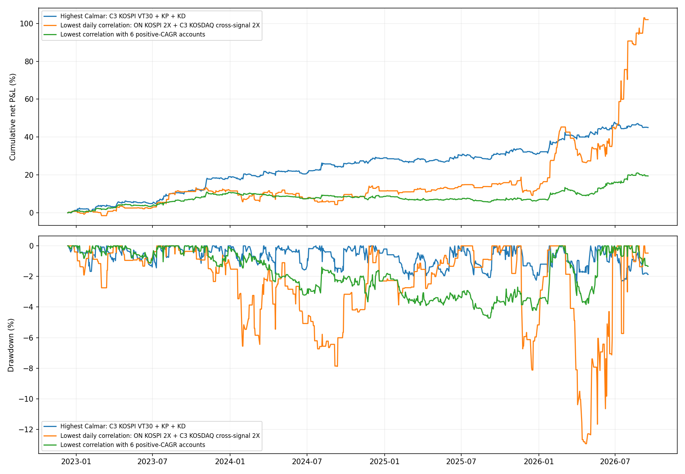
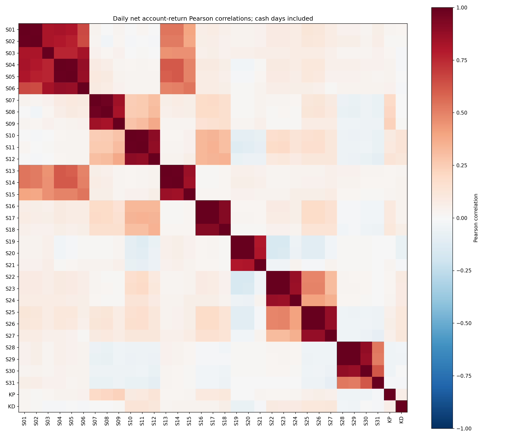

# 레버리지·코스닥 이식 전략의 조합 선정

평가 2022-12-13~2026-09-17, 919거래일. 신규 데이터가 더 최근까지 있어도 기존 6계좌 비교와 같은 공통 기간을 유지했다.

후보 33개, 신호 그룹 13개. 비어 있지 않은 조합 8,388,607개를 전수 탐색했고, 최종 조합 선정은 2계좌 이상 8,388,574개 중에서 했다. 같은 family/market/signal_mode의 1X·2X·VT30 중 하나만 선택한다. 서로 다른 시장 또는 서로 다른 수급/신호 정의는 별도 그룹이다. KP·KD는 선택 가능한 후보이며 필수는 아니다.

각 선택 계좌에 동일한 초기자본을 배정하고 계좌별 복리 자산을 합산한다. 계좌 사이 리밸런싱·자금 이동은 없다. 통합 일별 수익은 합산 자산의 전일 대비 변화다. 평균 일별 수익률을 복리로 계산하지 않는다. 최초 자산을 고점에 포함해 MDD를 계산하고 CAGR=(최종자산/초기자산)^(252/919)−1, Calmar=CAGR/|MDD|, Sharpe=일별 평균/표준편차×√252를 사용한다.

비용은 모든 후보에서 수수료 왕복 3bp+슬리피지 왕복 2bp다. ETF 변형은 기존 비교의 진입비중×왕복 5bp 차감, KP·KD는 기존 주문별 매수/매도 비용 모델이다. 거래하지 않는 날은 계좌 수익 0이다. W40 기존 수급 버전은 자료 준비 전 현금 기간이 있으며 새 코스닥 순매수 버전은 2015년 수급으로 번인한다.

상관 최소 목적은 전략 쌍의 일별 순수익률 Pearson 상관 절대값의 평균이다. 음의 상관은 헤지에 유용할 수 있지만 절대값이 크면 독립적이지 않으므로 평균 부호 상관도 함께 저장했다. 주별 상관과 모든 개별 전략 CAGR가 양수인 경우도 별도 보고한다. 평균 절대상관의 무제약 최솟값은 두 전략 쌍에서 얻어지므로, 6계좌 및 계좌 수별 결과도 함께 제시한다.

## 선정 결과

| selection | accounts | CAGR | MDD | Sharpe | Calmar | mean_abs_corr | mean_abs_weekly_corr |
| --- | --- | --- | --- | --- | --- | --- | --- |
| MAX_CALMAR | 3 | 10.73% | -2.44% | 1.7490 | 4.4068 | 0.1025 | 0.1053 |
| MIN_ABS_CORR | 2 | 21.27% | -12.94% | 1.2939 | 1.6435 | 0.0001 | 0.1590 |
| MIN_ABS_CORR_ALL_POSITIVE | 2 | 21.27% | -12.94% | 1.2939 | 1.6435 | 0.0001 | 0.1590 |
| MAX_CALMAR_WITH_KP_KD | 3 | 10.73% | -2.44% | 1.7490 | 4.4068 | 0.1025 | 0.1053 |
| MIN_ABS_CORR_6_POSITIVE | 6 | 4.99% | -4.72% | 1.1640 | 1.0567 | 0.0325 | 0.0731 |

### MAX_CALMAR

- C3_KOSPI_KOSPI_SIGNAL_VT30
- KP
- KD

각 계좌 최초 비중 33.33%. 운용 중 비중은 각 계좌의 손익에 따라 달라진다.

### MIN_ABS_CORR

- ON_KOSPI_KOSPI_SIGNAL_2X
- C3_KOSDAQ_KOSPI_SIGNAL_2X

각 계좌 최초 비중 50.00%. 운용 중 비중은 각 계좌의 손익에 따라 달라진다.

### MIN_ABS_CORR_ALL_POSITIVE

- ON_KOSPI_KOSPI_SIGNAL_2X
- C3_KOSDAQ_KOSPI_SIGNAL_2X

각 계좌 최초 비중 50.00%. 운용 중 비중은 각 계좌의 손익에 따라 달라진다.

### MAX_CALMAR_WITH_KP_KD

- C3_KOSPI_KOSPI_SIGNAL_VT30
- KP
- KD

각 계좌 최초 비중 33.33%. 운용 중 비중은 각 계좌의 손익에 따라 달라진다.

### MIN_ABS_CORR_6_POSITIVE

- ON_KOSDAQ_KOSPI_SIGNAL_2X
- C3_KOSDAQ_NATIVE_1X
- W40_KOSPI_KOSPI_FLOW_VT30
- SC_KOSDAQ_KOSPI_OPTIONS_1X
- KP
- KD

각 계좌 최초 비중 16.67%. 운용 중 비중은 각 계좌의 손익에 따라 달라진다.

## 선정 조합의 거래일·주별 상관

| selection | left | right | daily_corr | weekly_corr | both_active_days | both_active_corr |
| --- | --- | --- | --- | --- | --- | --- |
| MAX_CALMAR | KP | C3_KOSPI_KOSPI_SIGNAL_VT30 | 0.22994532533305503 | 0.21070725429665504 | 57 | 0.7264480256374765 |
| MAX_CALMAR | KD | C3_KOSPI_KOSPI_SIGNAL_VT30 | 0.009908658731898229 | -0.09393302019150125 | 51 | 0.06852453102548903 |
| MAX_CALMAR | KD | KP | 0.06749820519314814 | -0.011295095330318439 | 181 | 0.14101231858679683 |
| MIN_ABS_CORR | C3_KOSDAQ_KOSPI_SIGNAL_2X | ON_KOSPI_KOSPI_SIGNAL_2X | -0.00010977566294488113 | -0.15903820512441563 | 21 | 0.19731972058401437 |

최저 일별 상관 조합도 두 전략 모두 손익이 발생한 날은 21일이며 그 조건부 상관은 약 0.197, 주별 상관은 약 0.159다. 전체 일별 상관이 거의 0이라는 이유만으로 독립 알파가 입증된 것은 아니다. 해당 조합의 2026년 평가기간 수익이 약 79.30%로 전체 성과에 크게 기여했다.

## 계좌 수별 최상위 조합

| selection | accounts | CAGR | MDD | Sharpe | Calmar | mean_abs_corr | mean_abs_weekly_corr |
| --- | --- | --- | --- | --- | --- | --- | --- |
| 2계좌 최대 Calmar | 2 | 12.87% | -3.74% | 1.8067 | 3.4398 | 0.0241 | 0.0872 |
| 3계좌 최대 Calmar | 3 | 10.73% | -2.44% | 1.7490 | 4.4068 | 0.1025 | 0.1053 |
| 4계좌 최대 Calmar | 4 | 9.60% | -2.28% | 1.7490 | 4.2158 | 0.1554 | 0.1507 |
| 5계좌 최대 Calmar | 5 | 8.90% | -2.24% | 1.8327 | 3.9652 | 0.1013 | 0.1237 |
| 6계좌 최대 Calmar | 6 | 6.72% | -1.77% | 1.7443 | 3.7936 | 0.0578 | 0.0676 |
| 7계좌 최대 Calmar | 7 | 8.17% | -2.34% | 2.0231 | 3.4859 | 0.0934 | 0.1140 |
| 8계좌 최대 Calmar | 8 | 6.61% | -1.96% | 1.8112 | 3.3793 | 0.0975 | 0.1021 |
| 9계좌 최대 Calmar | 9 | 5.97% | -1.89% | 1.8073 | 3.1505 | 0.0825 | 0.0982 |
| 10계좌 최대 Calmar | 10 | 5.22% | -1.79% | 1.6849 | 2.9218 | 0.0814 | 0.0914 |
| 11계좌 최대 Calmar | 11 | 8.24% | -3.07% | 1.7756 | 2.6857 | 0.0787 | 0.1076 |
| 12계좌 최대 Calmar | 12 | 7.46% | -2.96% | 1.7049 | 2.5212 | 0.0825 | 0.1052 |
| 13계좌 최대 Calmar | 13 | 6.80% | -2.91% | 1.5793 | 2.3349 | 0.0866 | 0.1074 |

| selection | accounts | CAGR | MDD | Sharpe | Calmar | mean_abs_corr | mean_abs_weekly_corr |
| --- | --- | --- | --- | --- | --- | --- | --- |
| 2계좌 양수 전략 상관 최소 | 2 | 21.27% | -12.94% | 1.2939 | 1.6435 | 0.0001 | 0.1590 |
| 3계좌 양수 전략 상관 최소 | 3 | 4.68% | -3.40% | 1.0766 | 1.3776 | 0.0062 | 0.0726 |
| 4계좌 양수 전략 상관 최소 | 4 | 4.24% | -6.20% | 0.9416 | 0.6838 | 0.0143 | 0.0554 |
| 5계좌 양수 전략 상관 최소 | 5 | 9.58% | -3.85% | 1.8336 | 2.4891 | 0.0205 | 0.0758 |
| 6계좌 양수 전략 상관 최소 | 6 | 4.99% | -4.72% | 1.1640 | 1.0567 | 0.0325 | 0.0731 |
| 7계좌 양수 전략 상관 최소 | 7 | 10.17% | -4.57% | 1.8102 | 2.2277 | 0.0470 | 0.0887 |
| 8계좌 양수 전략 상관 최소 | 8 | 5.76% | -2.94% | 1.5041 | 1.9587 | 0.0610 | 0.1011 |
| 9계좌 양수 전략 상관 최소 | 9 | 5.84% | -2.92% | 1.4983 | 2.0017 | 0.0757 | 0.1250 |
| 10계좌 양수 전략 상관 최소 | 10 | 5.84% | -2.68% | 1.5407 | 2.1786 | 0.0845 | 0.1066 |

각 조합의 전체 구성은 ranked_candidates.csv에 있다.

## 개별 후보 성과와 정의

| short_code | variant | group | CAGR | MDD | Sharpe | Calmar |
| --- | --- | --- | --- | --- | --- | --- |
| S01 | ON_KOSPI_KOSPI_SIGNAL_1X | ON/KOSPI/KOSPI_SIGNAL | 13.82% | -11.30% | 1.0872863312479963 | 1.2226667052220324 |
| S02 | ON_KOSPI_KOSPI_SIGNAL_2X | ON/KOSPI/KOSPI_SIGNAL | 29.02% | -21.83% | 1.1197690510561875 | 1.3293742328167453 |
| S03 | ON_KOSPI_KOSPI_SIGNAL_VT30 | ON/KOSPI/KOSPI_SIGNAL | 5.98% | -18.43% | 0.6635348490444859 | 0.3244032343801753 |
| S04 | ON_KOSDAQ_KOSPI_SIGNAL_1X | ON/KOSDAQ/KOSPI_SIGNAL | 1.96% | -16.45% | 0.2705257725918057 | 0.1194536479026779 |
| S05 | ON_KOSDAQ_KOSPI_SIGNAL_2X | ON/KOSDAQ/KOSPI_SIGNAL | 1.74% | -28.73% | 0.1861963120559524 | 0.0606825580114731 |
| S06 | ON_KOSDAQ_KOSPI_SIGNAL_VT30 | ON/KOSDAQ/KOSPI_SIGNAL | -0.63% | -17.73% | -0.0618548437801767 | -0.0355788002639532 |
| S07 | C3_KOSPI_KOSPI_SIGNAL_1X | C3/KOSPI/KOSPI_SIGNAL | 9.14% | -5.60% | 1.3895277133370794 | 1.6305295585993786 |
| S08 | C3_KOSPI_KOSPI_SIGNAL_2X | C3/KOSPI/KOSPI_SIGNAL | 17.44% | -9.98% | 1.293007200180218 | 1.7480788363378172 |
| S09 | C3_KOSPI_KOSPI_SIGNAL_VT30 | C3/KOSPI/KOSPI_SIGNAL | 11.90% | -4.70% | 1.7205639883792228 | 2.530005389639649 |
| S10 | C3_KOSDAQ_KOSPI_SIGNAL_1X | C3/KOSDAQ/KOSPI_SIGNAL | 6.36% | -18.16% | 0.7280205328601457 | 0.3503762304567282 |
| S11 | C3_KOSDAQ_KOSPI_SIGNAL_2X | C3/KOSDAQ/KOSPI_SIGNAL | 11.91% | -31.96% | 0.7142303148425363 | 0.3727537688213183 |
| S12 | C3_KOSDAQ_KOSPI_SIGNAL_VT30 | C3/KOSDAQ/KOSPI_SIGNAL | 5.99% | -10.40% | 0.7862596620171874 | 0.576048585770765 |
| S13 | ON_KOSDAQ_NATIVE_1X | ON/KOSDAQ/NATIVE | -4.38% | -25.04% | -0.3939051868195131 | -0.1747134260579658 |
| S14 | ON_KOSDAQ_NATIVE_2X | ON/KOSDAQ/NATIVE | -9.06% | -43.34% | -0.4087821839738228 | -0.2089417505391584 |
| S15 | ON_KOSDAQ_NATIVE_VT30 | ON/KOSDAQ/NATIVE | -3.43% | -25.82% | -0.4022047338342886 | -0.1326805092725768 |
| S16 | C3_KOSDAQ_NATIVE_1X | C3/KOSDAQ/NATIVE | 3.98% | -10.32% | 0.5018648929289552 | 0.3856552285137528 |
| S17 | C3_KOSDAQ_NATIVE_2X | C3/KOSDAQ/NATIVE | 6.30% | -19.59% | 0.4517737898209503 | 0.3216644491969149 |
| S18 | C3_KOSDAQ_NATIVE_VT30 | C3/KOSDAQ/NATIVE | 3.90% | -13.39% | 0.5131585803986088 | 0.2916457291200034 |
| S19 | W40_KOSPI_KOSPI_FLOW_1X | W40/KOSPI/KOSPI_FLOW | 0.90% | -6.00% | 0.252430624940443 | 0.149917981425576 |
| S20 | W40_KOSPI_KOSPI_FLOW_2X | W40/KOSPI/KOSPI_FLOW | 3.88% | -8.87% | 0.5343984508954943 | 0.4380469105654656 |
| S21 | W40_KOSPI_KOSPI_FLOW_VT30 | W40/KOSPI/KOSPI_FLOW | 0.36% | -5.36% | 0.1317181075448315 | 0.0678967070544552 |
| S22 | W40_KOSDAQ_KOSPI_FLOW_1X | W40/KOSDAQ/KOSPI_FLOW | -1.64% | -14.46% | -0.3021417953741213 | -0.113650573475098 |
| S23 | W40_KOSDAQ_KOSPI_FLOW_2X | W40/KOSDAQ/KOSPI_FLOW | -1.15% | -21.65% | -0.0682577444299524 | -0.0529333725120673 |
| S24 | W40_KOSDAQ_KOSPI_FLOW_VT30 | W40/KOSDAQ/KOSPI_FLOW | -2.89% | -13.63% | -0.8366887538545821 | -0.2119754656532717 |
| S25 | W40_KOSDAQ_NET_PROXY_1X | W40/KOSDAQ/NET_PROXY | -2.48% | -14.90% | -0.3975287255809095 | -0.1663928354098113 |
| S26 | W40_KOSDAQ_NET_PROXY_2X | W40/KOSDAQ/NET_PROXY | -0.59% | -19.10% | 0.0062045545843081 | -0.030632461811366 |
| S27 | W40_KOSDAQ_NET_PROXY_VT30 | W40/KOSDAQ/NET_PROXY | -2.19% | -12.43% | -0.4129573992882925 | -0.176543378293732 |
| S28 | SC_KOSPI_KOSPI_OPTIONS_1X | SC/KOSPI/KOSPI_OPTIONS | 1.11% | -10.63% | 0.2153153616677845 | 0.1040982914381963 |
| S29 | SC_KOSPI_KOSPI_OPTIONS_2X | SC/KOSPI/KOSPI_OPTIONS | 3.66% | -18.73% | 0.3558909870208652 | 0.1952622134134596 |
| S30 | SC_KOSPI_KOSPI_OPTIONS_VT30 | SC/KOSPI/KOSPI_OPTIONS | 0.75% | -11.27% | 0.1684308413552346 | 0.0666970440903114 |
| S31 | SC_KOSDAQ_KOSPI_OPTIONS_1X | SC/KOSDAQ/KOSPI_OPTIONS | 2.42% | -9.23% | 0.4278129237519806 | 0.2616879562685369 |
| KP | KP | KP/KP/FROZEN_FINAL | 7.56% | -4.35% | 0.9285004519200506 | 1.7372964794369112 |
| KD | KD | KD/KD/FROZEN_FINAL | 12.56% | -9.07% | 1.015245179929737 | 1.3846112041769834 |

KP는 기존 코스피 intraday final(롱 전용, 최대 2배), KD는 기존 코스닥 intraday final(양방향, 최대 1배)이다. 원래 frozen 선택과 일별 수익률을 그대로 사용했다. 새 KD 레버리지 변형은 이번 후보에 추가로 만들지 않았다.

## 새 데이터 처리와 미완료 버전

코스닥 선물 파일의 5번째 foreign 열을 그대로 외국인 순매수로 사용했다. 원본은 내림차순이므로 날짜를 오름차순으로 정렬하고 실제 직전 KRX 거래일로 lag했다. 코스닥150 지수의 2024-10-08 중복 두 행은 모든 값이 같아 계산에서 하나만 사용했다. 원본 CSV는 변경하지 않았다.

ON NATIVE는 미국 proxy 조건을 유지하고 수급을 전일 코스닥150 선물 순매수>0으로 교체했다. C3 NATIVE는 코스닥150 지수 시가 갭을 SPX 미국 종가 누적수익으로 설명하는 직전 250일 OLS(최소 200일), 잔차 z≥1 및 229200 상대 시가 할인≤0 규칙을 사용한다. VT30은 native 지수 변동성을 사용한다.

W40 NET_PROXY는 외국인 순매수값의 직전 250일 60% 분위수 이상 조건이다. 원형의 순매수/(매수+매도) 비율과 다르며 원형 이식으로 부르지 않는다. W40 가격 신호는 229200 ORB/VWAP, 다음 거래량>0 분봉 open 진입, 원형처럼 30개의 유효 봉 뒤 close 청산이다. 레버리지는 가격 신호를 바꾸지 않고 실제 233740 체결가로 적용한다.

| variant | status | reason |
| --- | --- | --- |
| SC_KOSDAQ_KOSPI_OPTIONS_2X | NOT_RUN | No KOSDAQ -2x ETF in the permitted vehicle universe; margin futures/ETN require a separate model |
| SC_KOSDAQ_KOSPI_OPTIONS_VT30 | NOT_RUN | No KOSDAQ -2x ETF in the permitted vehicle universe; margin futures/ETN require a separate model |
| W40_KOSDAQ_NATIVE_1X | NOT_RUN | Only net-buy available; normalized net/(buy+sell) requires daily buy/sell amounts; separate NET_PROXY tested |
| W40_KOSDAQ_NATIVE_2X | NOT_RUN | Only net-buy available; normalized net/(buy+sell) requires daily buy/sell amounts; separate NET_PROXY tested |
| W40_KOSDAQ_NATIVE_VT30 | NOT_RUN | Only net-buy available; normalized net/(buy+sell) requires daily buy/sell amounts; separate NET_PROXY tested |
| SC_KOSDAQ_NATIVE_1X | NOT_RUN | KOSDAQ150 options foreign put / individual call daily buy/sell amounts and 60-session warmup missing |
| SC_KOSDAQ_NATIVE_2X | NOT_RUN | KOSDAQ150 options foreign put / individual call daily buy/sell amounts and 60-session warmup missing |
| SC_KOSDAQ_NATIVE_VT30 | NOT_RUN | KOSDAQ150 options foreign put / individual call daily buy/sell amounts and 60-session warmup missing |

아직 필요한 것은 W40 원형용 외국인 매수·매도 금액, SC 코스닥 고유 신호용 옵션 콜·풋 투자자별 매수·매도 금액이다. SC 코스닥 2배 숏은 허용 ETF 목록에서 구현할 차량이 없어 제외했다.

## 해석의 한계

선정은 전체 과거 표본을 관측한 뒤 800만 개 이상 조합을 비교한 사후 결과다. 새로운 표본 외 성과가 아니다. selected_yearly.csv와 주별 상관으로 기간 의존성을 확인해야 한다. 낮은 전체 일별 상관은 현금일로 희석될 수 있다. 개별 전략의 양의 CAGR 역시 미래 기대수익을 보장하지 않는다.

C3는 확정된 당일 지수/ETF 시가로 신호를 계산하고 같은 시가에 체결하는 원형의 시간 가정을 보존했다. C3가 포함된 최고 Calmar 조합은 실거래 가능한 진입 지연 검증을 마친 결과가 아니다. 다음 분봉 진입 등으로 재평가하면 조합 순위가 달라질 수 있다. 일별 MDD는 장중 및 야간 미실현 최악의 낙폭까지 측정한 값이 아니다.

## 검증

계좌 수별 탐색 개수는 생성함수 ∏(1+그룹 내 후보 수×x)의 계수와 정확히 일치했다. 저장된 모든 상위/최저상관 조합의 CAGR·MDD·Calmar·상관을 Python에서 계좌별 자산 합산으로 독립 재계산했다. 최소상관 결과는 허용되는 모든 두 전략 쌍을 별도로 계산해 확인했다.

## 실행

`python jehyeong/overnight/compare_committed_strategies.py --transfer-leverage` 후 `python jehyeong/overnight/compare_committed_strategies.py --select-alpha-pool`.