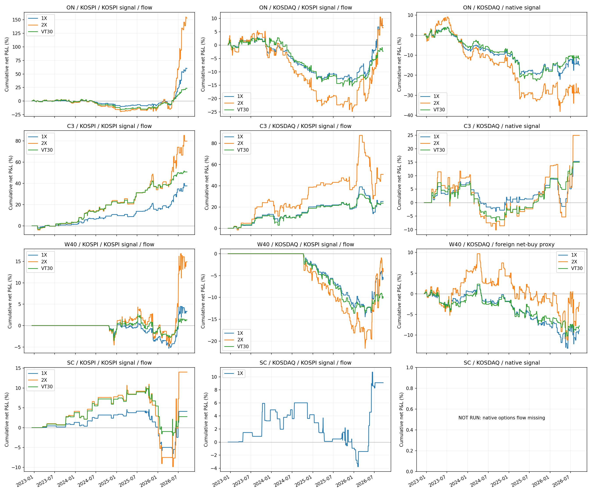

# 코스닥 이식·레버리지 변형 검증

평가 2022-12-13~2026-09-17, 919거래일. 완료 31개, 미실행 8개. 추가 수집은 실행하지 않았다.

## 새 입력으로 완료한 변형

| 전략 | 평가기간 | 거래 | 누적수익률 | CAGR | MDD | Sharpe | Calmar |
|---|---|---:|---:|---:|---:|---:|---:|
| ON_KOSDAQ_NATIVE_1X | 2022-12-13~2026-09-17 | 203 | -15.05% | -4.38% | -25.04% | -0.394 | -0.175 |
| ON_KOSDAQ_NATIVE_2X | 2022-12-13~2026-09-17 | 203 | -29.26% | -9.06% | -43.34% | -0.409 | -0.209 |
| ON_KOSDAQ_NATIVE_VT30 | 2022-12-13~2026-09-17 | 203 | -11.94% | -3.43% | -25.82% | -0.402 | -0.133 |
| C3_KOSDAQ_NATIVE_1X | 2022-12-13~2026-09-17 | 85 | 15.30% | 3.98% | -10.32% | 0.502 | 0.386 |
| C3_KOSDAQ_NATIVE_2X | 2022-12-13~2026-09-17 | 85 | 24.97% | 6.30% | -19.59% | 0.452 | 0.322 |
| C3_KOSDAQ_NATIVE_VT30 | 2022-12-13~2026-09-17 | 85 | 14.99% | 3.90% | -13.39% | 0.513 | 0.292 |
| W40_KOSDAQ_KOSPI_FLOW_2X | 2022-12-13~2026-09-17 | 123 | -4.12% | -1.15% | -21.65% | -0.068 | -0.053 |
| W40_KOSDAQ_KOSPI_FLOW_VT30 | 2022-12-13~2026-09-17 | 123 | -10.14% | -2.89% | -13.63% | -0.837 | -0.212 |
| W40_KOSDAQ_NET_PROXY_1X | 2022-12-13~2026-09-17 | 240 | -8.75% | -2.48% | -14.90% | -0.398 | -0.166 |
| W40_KOSDAQ_NET_PROXY_2X | 2022-12-13~2026-09-17 | 240 | -2.12% | -0.59% | -19.10% | 0.006 | -0.031 |
| W40_KOSDAQ_NET_PROXY_VT30 | 2022-12-13~2026-09-17 | 240 | -7.77% | -2.19% | -12.43% | -0.413 | -0.177 |
| SC_KOSPI_KOSPI_OPTIONS_2X | 2022-12-13~2026-09-17 | 56 | 14.00% | 3.66% | -18.73% | 0.356 | 0.195 |
| SC_KOSPI_KOSPI_OPTIONS_VT30 | 2022-12-13~2026-09-17 | 56 | 2.77% | 0.75% | -11.27% | 0.168 | 0.067 |

ON NATIVE는 미국 proxy 조건을 유지하고 전일 외국인 순매수를 코스닥150 선물로 교체했다. C3 NATIVE는 코스닥150 지수 갭의 직전 250일 OLS 잔차 z≥1와 229200 시가 할인≤0을 함께 확인한다. SPX 설명변수와 임계값은 원형을 유지했다.

W40 NET_PROXY는 외국인 순매수값의 직전 250일 상위 40%다. 기존 순매수/(매수+매도) 정규화 수급과 다르며, 추후 매수·매도 금액을 확보하면 원형 이식을 별도로 검증한다. 가격 신호는 코스닥 1배 ETF의 ORB/VWAP, 다음 거래량>0 분봉 open 진입, 30개 유효 봉 뒤 close 청산이다.

233740 분봉으로 W40 코스닥 레버리지 체결을, 252670 일봉으로 SC 코스피 인버스2X와 혼합을 실행했다. 실제 해당 ETF 가격을 사용하며 1배 손익을 단순 두 배로 만들지 않는다.

## 전체 성과

| 전략 | 평가기간 | 거래 | 누적수익률 | CAGR | MDD | Sharpe | Calmar |
|---|---|---:|---:|---:|---:|---:|---:|
| ON_KOSPI_KOSPI_SIGNAL_1X | 2022-12-13~2026-09-17 | 191 | 60.31% | 13.82% | -11.30% | 1.087 | 1.223 |
| ON_KOSPI_KOSPI_SIGNAL_2X | 2022-12-13~2026-09-17 | 191 | 153.28% | 29.02% | -21.83% | 1.120 | 1.329 |
| ON_KOSPI_KOSPI_SIGNAL_VT30 | 2022-12-13~2026-09-17 | 191 | 23.58% | 5.98% | -18.43% | 0.664 | 0.324 |
| ON_KOSDAQ_KOSPI_SIGNAL_1X | 2022-12-13~2026-09-17 | 191 | 7.35% | 1.96% | -16.45% | 0.271 | 0.119 |
| ON_KOSDAQ_KOSPI_SIGNAL_2X | 2022-12-13~2026-09-17 | 191 | 6.51% | 1.74% | -28.73% | 0.186 | 0.061 |
| ON_KOSDAQ_KOSPI_SIGNAL_VT30 | 2022-12-13~2026-09-17 | 191 | -2.28% | -0.63% | -17.73% | -0.062 | -0.036 |
| C3_KOSPI_KOSPI_SIGNAL_1X | 2022-12-13~2026-09-17 | 100 | 37.56% | 9.14% | -5.60% | 1.390 | 1.631 |
| C3_KOSPI_KOSPI_SIGNAL_2X | 2022-12-13~2026-09-17 | 100 | 79.71% | 17.44% | -9.98% | 1.293 | 1.748 |
| C3_KOSPI_KOSPI_SIGNAL_VT30 | 2022-12-13~2026-09-17 | 100 | 50.70% | 11.90% | -4.70% | 1.721 | 2.530 |
| C3_KOSDAQ_KOSPI_SIGNAL_1X | 2022-12-13~2026-09-17 | 100 | 25.23% | 6.36% | -18.16% | 0.728 | 0.350 |
| C3_KOSDAQ_KOSPI_SIGNAL_2X | 2022-12-13~2026-09-17 | 100 | 50.75% | 11.91% | -31.96% | 0.714 | 0.373 |
| C3_KOSDAQ_KOSPI_SIGNAL_VT30 | 2022-12-13~2026-09-17 | 100 | 23.64% | 5.99% | -10.40% | 0.786 | 0.576 |
| ON_KOSDAQ_NATIVE_1X | 2022-12-13~2026-09-17 | 203 | -15.05% | -4.38% | -25.04% | -0.394 | -0.175 |
| ON_KOSDAQ_NATIVE_2X | 2022-12-13~2026-09-17 | 203 | -29.26% | -9.06% | -43.34% | -0.409 | -0.209 |
| ON_KOSDAQ_NATIVE_VT30 | 2022-12-13~2026-09-17 | 203 | -11.94% | -3.43% | -25.82% | -0.402 | -0.133 |
| C3_KOSDAQ_NATIVE_1X | 2022-12-13~2026-09-17 | 85 | 15.30% | 3.98% | -10.32% | 0.502 | 0.386 |
| C3_KOSDAQ_NATIVE_2X | 2022-12-13~2026-09-17 | 85 | 24.97% | 6.30% | -19.59% | 0.452 | 0.322 |
| C3_KOSDAQ_NATIVE_VT30 | 2022-12-13~2026-09-17 | 85 | 14.99% | 3.90% | -13.39% | 0.513 | 0.292 |
| W40_KOSPI_KOSPI_FLOW_1X | 2022-12-13~2026-09-17 | 149 | 3.32% | 0.90% | -6.00% | 0.252 | 0.150 |
| W40_KOSPI_KOSPI_FLOW_2X | 2022-12-13~2026-09-17 | 149 | 14.91% | 3.88% | -8.87% | 0.534 | 0.438 |
| W40_KOSPI_KOSPI_FLOW_VT30 | 2022-12-13~2026-09-17 | 149 | 1.33% | 0.36% | -5.36% | 0.132 | 0.068 |
| W40_KOSDAQ_KOSPI_FLOW_1X | 2022-12-13~2026-09-17 | 123 | -5.86% | -1.64% | -14.46% | -0.302 | -0.114 |
| W40_KOSDAQ_KOSPI_FLOW_2X | 2022-12-13~2026-09-17 | 123 | -4.12% | -1.15% | -21.65% | -0.068 | -0.053 |
| W40_KOSDAQ_KOSPI_FLOW_VT30 | 2022-12-13~2026-09-17 | 123 | -10.14% | -2.89% | -13.63% | -0.837 | -0.212 |
| W40_KOSDAQ_NET_PROXY_1X | 2022-12-13~2026-09-17 | 240 | -8.75% | -2.48% | -14.90% | -0.398 | -0.166 |
| W40_KOSDAQ_NET_PROXY_2X | 2022-12-13~2026-09-17 | 240 | -2.12% | -0.59% | -19.10% | 0.006 | -0.031 |
| W40_KOSDAQ_NET_PROXY_VT30 | 2022-12-13~2026-09-17 | 240 | -7.77% | -2.19% | -12.43% | -0.413 | -0.177 |
| SC_KOSPI_KOSPI_OPTIONS_1X | 2022-12-13~2026-09-17 | 56 | 4.09% | 1.11% | -10.63% | 0.215 | 0.104 |
| SC_KOSPI_KOSPI_OPTIONS_2X | 2022-12-13~2026-09-17 | 56 | 14.00% | 3.66% | -18.73% | 0.356 | 0.195 |
| SC_KOSPI_KOSPI_OPTIONS_VT30 | 2022-12-13~2026-09-17 | 56 | 2.77% | 0.75% | -11.27% | 0.168 | 0.067 |
| SC_KOSDAQ_KOSPI_OPTIONS_1X | 2022-12-13~2026-09-17 | 56 | 9.09% | 2.42% | -9.23% | 0.428 | 0.262 |

## 계산 규칙

각 후보는 독립 계좌이며 미거래일은 0이다. 진입 ETF 비중×수수료 왕복 3bp+슬리피지 왕복 2bp를 차감하는 기존 공통 비교 방식을 유지한다. 매도 시 바뀐 평가금액 기준으로 비용을 다시 계산하는 방식과는 소폭 다르다. 분배금 현금 수령·재투자와 정수 주식 수 제약은 별도 반영하지 않았다.

1X는 1배 ETF 전액, 2X는 방향이 같은 2배 ETF 전액. VT30은 전일까지의 20일 종가수익률 SD×√252로 σ를 계산하고 w=clip(0.30/σ,0,2). w≤1은 1배 ETF w+현금 1−w, w>1은 1배 ETF 2−w+2배 ETF w−1이다. C3 코스피와 코스닥 NATIVE는 각각 지수 변동성, 나머지는 거래 대상 1배 ETF 변동성이다. 비중은 진입 시 고정하고 청산까지 유지한다.

분봉은 모두 끝시각 라벨이다. 다음 봉 open의 실제 시작 시각은 해당 라벨보다 1분 앞이다. 원형 W40의 30유효봉은 30시계분과 다를 수 있다. 여러 ETF는 같은 분봉의 open/close를 사용하며 체결량>0을 확인한다.

## 입력 점검

| foreign_fifth_column | foreign_missing_evaluation_days | identical_index_rows_dropped |
| --- | --- | --- |
| foreign | 0 | 1 |

외국인 순매수는 사람이 지정한 파일의 5번째 foreign 열을 사용했다. 모든 입력 날짜를 오름차순으로 정렬했다. 코스닥 지수의 2024-10-08 완전 동일 중복행 1개는 계산에서만 제거하고 원본은 보존했다.

## 미실행

| variant | status | reason |
| --- | --- | --- |
| SC_KOSDAQ_KOSPI_OPTIONS_2X | NOT_RUN | No KOSDAQ -2x ETF in the permitted vehicle universe; margin futures/ETN require a separate model |
| SC_KOSDAQ_KOSPI_OPTIONS_VT30 | NOT_RUN | No KOSDAQ -2x ETF in the permitted vehicle universe; margin futures/ETN require a separate model |
| W40_KOSDAQ_NATIVE_1X | NOT_RUN | Only net-buy available; normalized net/(buy+sell) requires daily buy/sell amounts; separate NET_PROXY tested |
| W40_KOSDAQ_NATIVE_2X | NOT_RUN | Only net-buy available; normalized net/(buy+sell) requires daily buy/sell amounts; separate NET_PROXY tested |
| W40_KOSDAQ_NATIVE_VT30 | NOT_RUN | Only net-buy available; normalized net/(buy+sell) requires daily buy/sell amounts; separate NET_PROXY tested |
| SC_KOSDAQ_NATIVE_1X | NOT_RUN | KOSDAQ150 options foreign put / individual call daily buy/sell amounts and 60-session warmup missing |
| SC_KOSDAQ_NATIVE_2X | NOT_RUN | KOSDAQ150 options foreign put / individual call daily buy/sell amounts and 60-session warmup missing |
| SC_KOSDAQ_NATIVE_VT30 | NOT_RUN | KOSDAQ150 options foreign put / individual call daily buy/sell amounts and 60-session warmup missing |

필요한 추가 자료는 W40 원형용 코스닥150 선물 외국인 매수·매도 금액, SC 고유 신호용 코스닥150 옵션 외국인 풋·개인 콜 매수·매도 금액이다. 코스닥 2배 숏은 이번 허용 ETF 목록으로 구현할 차량이 없다.

## 기존 전략 참조

| 전략 | 평가기간 | 거래 | 누적수익률 | CAGR | MDD | Sharpe | Calmar |
|---|---|---:|---:|---:|---:|---:|---:|
| JEHYEONG_PROXY | 2022-12-13~2026-09-17 | 191 | 60.31% | 13.82% | -11.30% | 1.087 | 1.223 |
| BEOMGU_C3_VT30 | 2022-12-13~2026-09-17 | 100 | 50.71% | 11.91% | -4.71% | 1.721 | 2.529 |
| WOOHYUN_TOP40_30 | 2022-12-13~2026-09-17 | 149 | 3.33% | 0.90% | -5.99% | 0.253 | 0.151 |
| SUNNY_C | 2022-12-13~2026-09-17 | 56 | 7.81% | 2.08% | -9.61% | 0.370 | 0.217 |

SC는 과거 지수 숏 프록시와 달리 실제 인버스 ETF를 거래해 성과가 달라진다. C3 등 다른 통제군은 같은 신호를 유지하되 가능한 경우 TOSS 가격으로 재평가했다.

C3는 확정된 시가 신호로 같은 시가에 체결하는 원형 가정을 그대로 갖고 있다. 이 결과는 다음 분봉 진입이나 장전 예상체결가의 실행 검증을 마친 성과가 아니다. 전체 표본에서 조합을 고르는 행위는 표본 외 검증이 아니며, 일별 MDD는 장중 최악의 낙폭까지 포함하지 않는다.

## 조합 선정

[전체 후보의 조합 선정 보고서](pool_selection/report.md)

## 재실행

`python jehyeong/overnight/compare_committed_strategies.py --transfer-leverage`

`python jehyeong/overnight/compare_committed_strategies.py --select-alpha-pool`